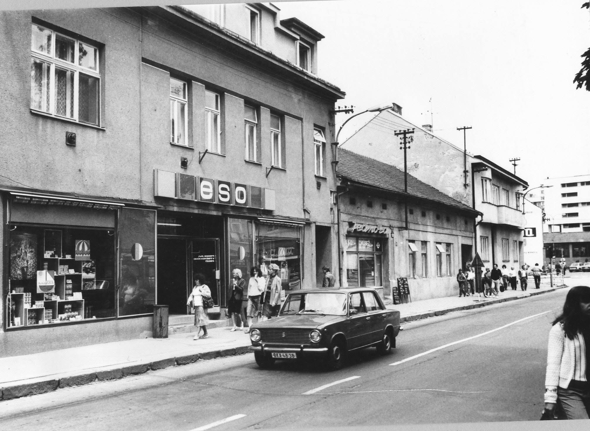
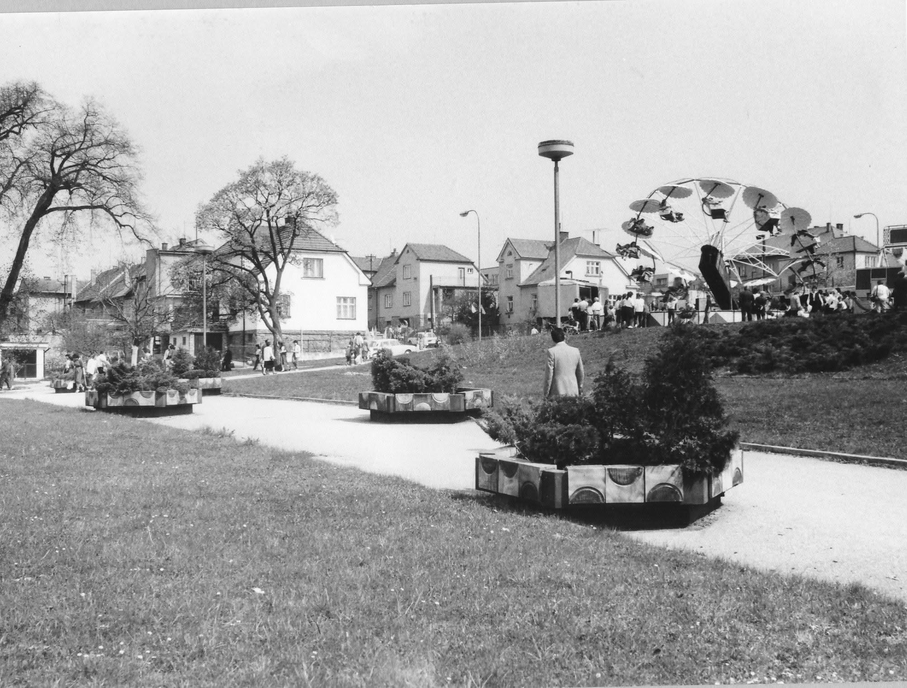
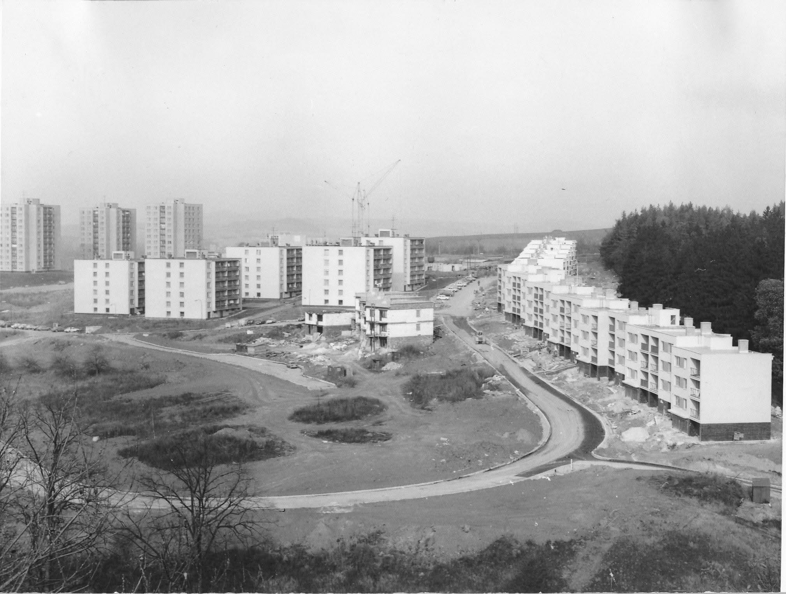

# A ještě historické foto Blanska - rok 1986 a 1987, sídliště Zborovce, kolotoče u Sýpky a luxusní prodejna Eso - spodní část Rožmitálky u vlakové zastávky  (dnes prodejna obuvi a dárkových předmětů)

**List:** centrum Blanska  
**Trello:** <https://trello.com/c/DnYr810h/121-a-je%C5%A1t%C4%9B-historick%C3%A9-foto-blanska-rok-1986-a-1987-s%C3%ADdli%C5%A1t%C4%9B-zborovce-koloto%C4%8De-u-s%C3%BDpky-a-luxusn%C3%AD-prodejna-eso-spodn%C3%AD-%C4%8D%C3%A1st-ro%C5%BEmit%C3%A1lky>  

[← zpět na list](../README.md)

## Přílohy (3)

