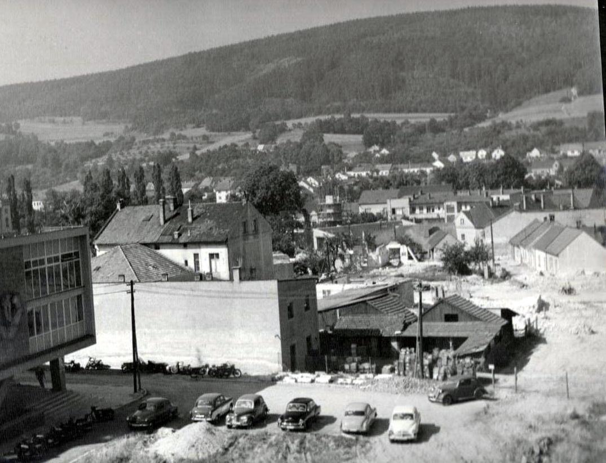
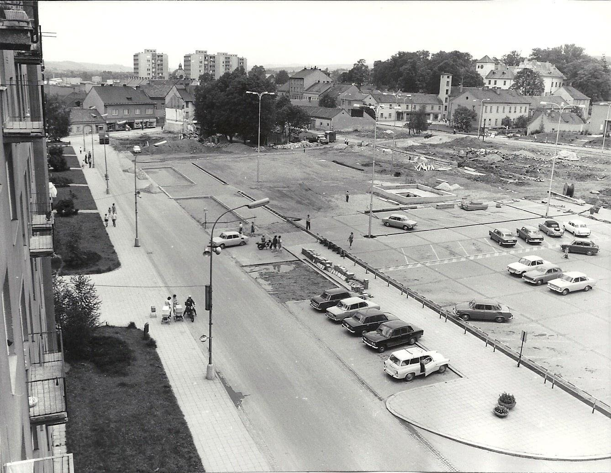
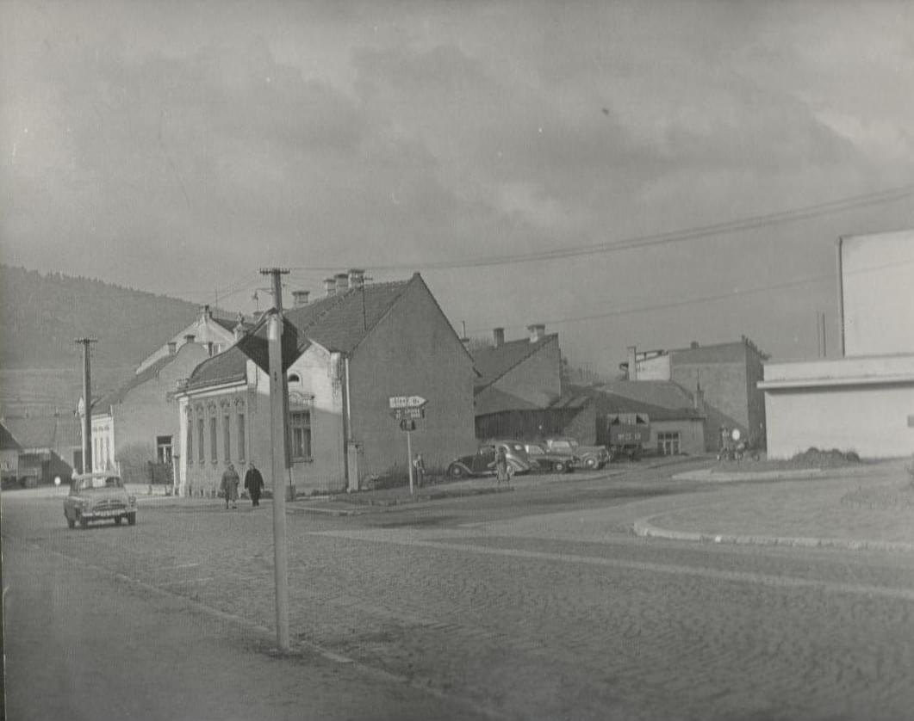

# BLANSKO 60. LÉTA 20. STOLETÍ

**List:** centrum Blanska  
**Trello:** <https://trello.com/c/U9T4ORAt/91-blansko-60-l%C3%A9ta-20-stolet%C3%AD>  

[← zpět na list](../README.md)

## Popis

Pavel Svoboda facebook

## Komentáře

**Miroslav Sid Martinek** (2024-11-07):

Jde o dnešní kruháč Smetanova, Sadová a Masarykova. V pravém rohu je dnešní budova MÚ (dříve ONV) Blansko

## Přílohy (3)

