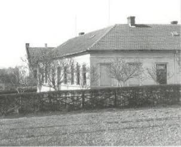

# Špitál (Tiro)

**List:** centrum Blanska  
**Trello:** <https://trello.com/c/LH5IK5ZR/99-%C5%A1pit%C3%A1l-tiro>  

[← zpět na list](../README.md)

## Popis

BLANSKO HISTORICKÉ.
Již před rokem1819 byl v Blansku obecní špitál. Stál před mostem na levém břehu Svitavy, v místě ústí potoku Palava do řeky (dnes dolní část Rožmitálovy ulice). Byl to zřejmě špitál, kam lazebník - ranlékař docházel a majitel domku, při prominutí jiných výkonů pro obec a obecních poplatků, měl povinnost se o nemocné bezdomovce starat. Podle zápisů tam v letech 1819 - 1825 byli umístěni čtyři nemocní a místnost v domku sloužila i jako občasná márnice.
Obec později zřídila na Starém Blansku špitál nový, ten měl číslo 135 (dnes ulice Brněnská č.10). Obecní výbor dal tento dům v letech 1888 - 1889 opravit a rozšířit.
V roce 1890 při onemocnění dítěte neštovicemi se zjistilo, že Blansko nemá dosud místnost, kam by bylo možné takové nemocné umístit. Proto Okresní hejtmanství v Boskovicích vytýká obci, že obec nevyhověla příkazu postavit nouzovou nemocnici. Nato obec zadala vypracování plánku a rozpočtu nemocnice pro 12 nemocných zednickému mistrovi Janu Hykrdovi z Rájce. Kníže Salm nechal na stavbu nemocnice pozemek a věnoval 300 zl. Vybraná parcela č. 766 byla nad severním začátkem Klepačovské ulice ( dnes  Havlíčkova 517/2) a stavba byla zadána staviteli Tomáši Klikovi z Tišnova. V roce 1894 byla budova nemocnice dostavěná (včetně dezinfekční komory a márnice) a zkolaudována. Nemocnice sloužila svému účelu pouze do roku 1906, kdy v této budově byla zřízena dívčí měšťanská škola. Po vypuknutí první světové války, kdy nemocnice nestačily přijímat raněné, byl v Blansku zřízen v této škole vojenský náhradní lazaret pro 40 mužů. Ten fungoval do roku 1915. Bylo v něm léčeno 38 raněných vojáků, většinou Čechů. Střídalo se zde několik ošetřovatelů, lékařem byl MUDr. Zdeněk Kožíšek.
Na snímku stará nemocnice, dnes budova TIRO, Havlíčkova 517/2.

## Přílohy (1)

