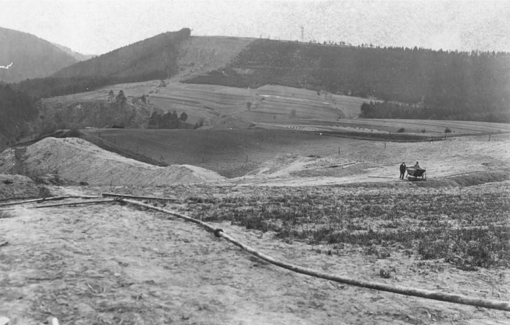
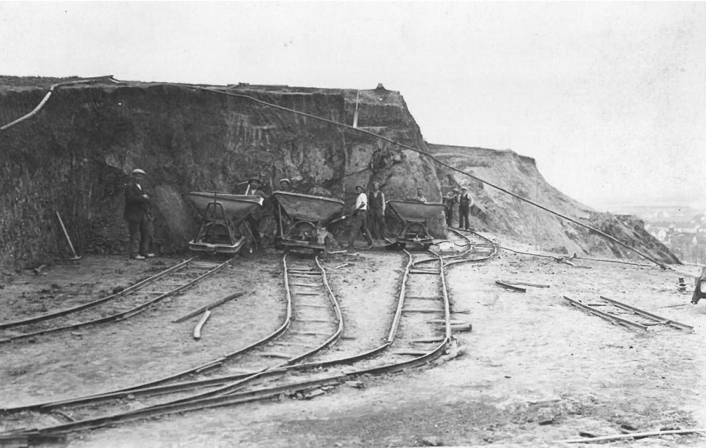
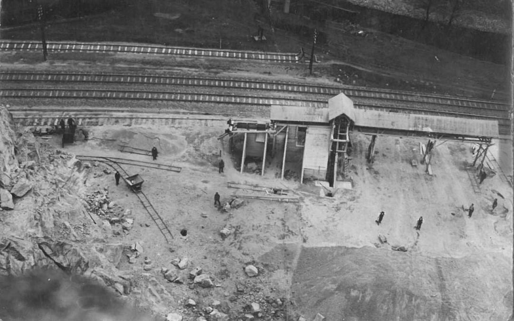
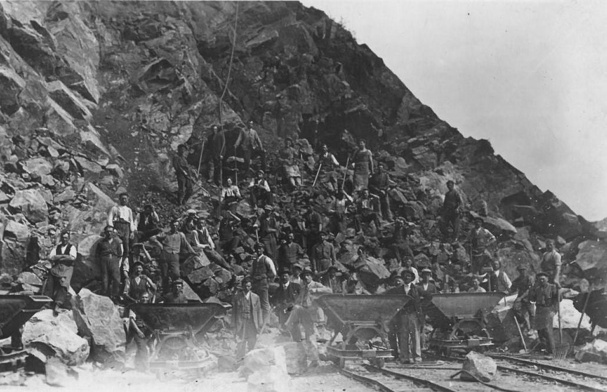
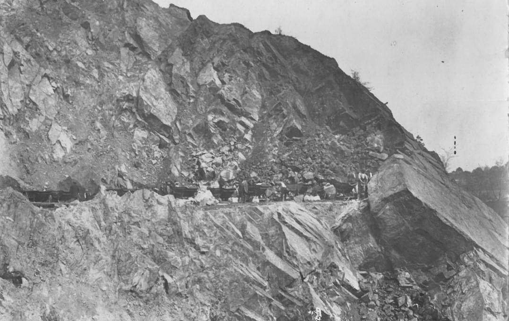
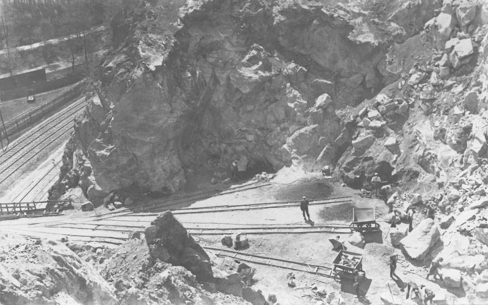
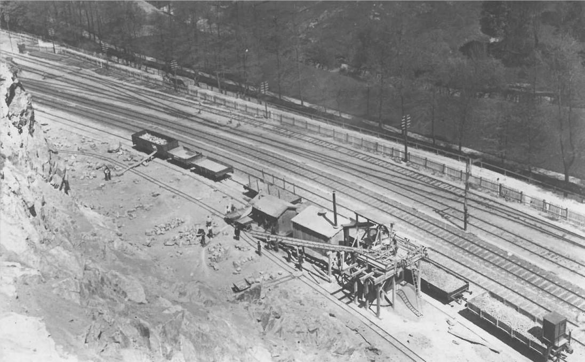
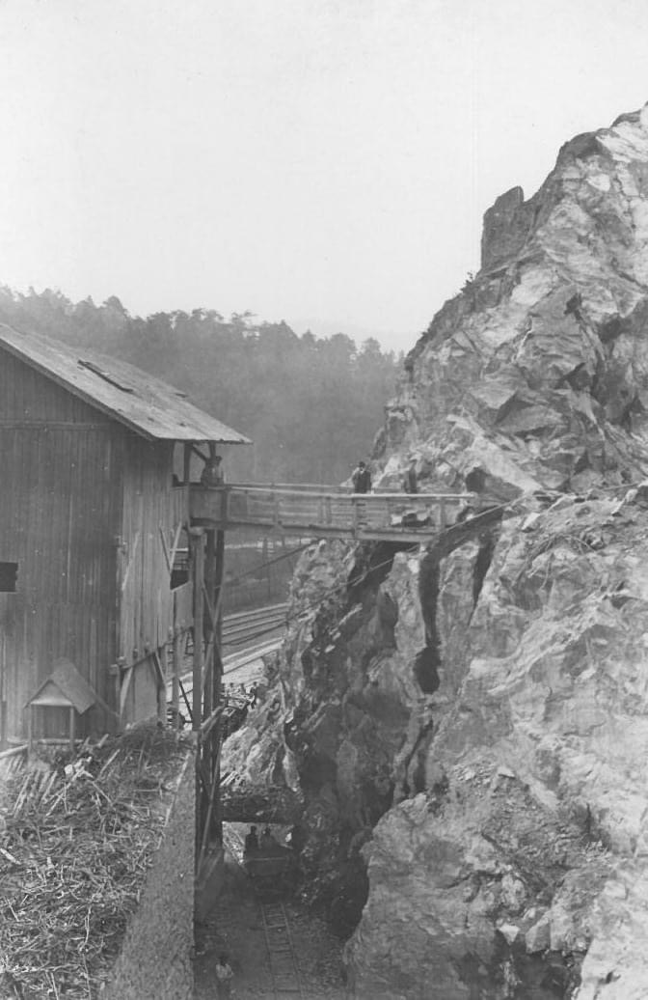
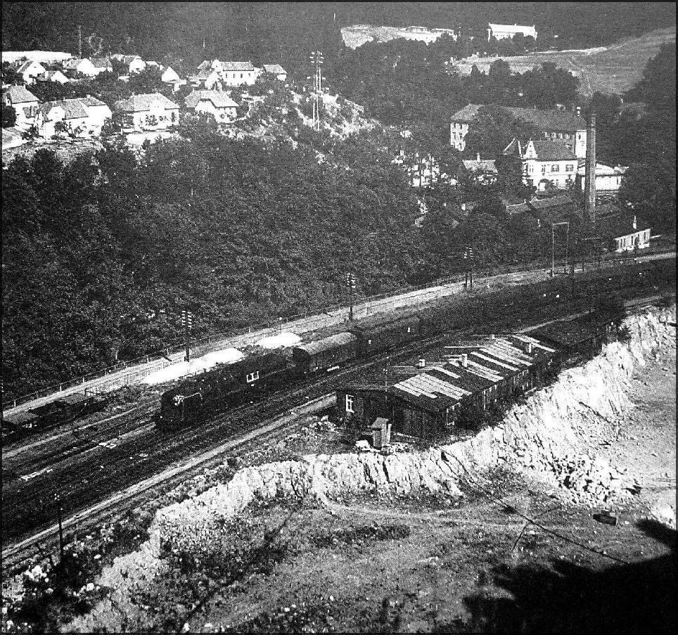

# Kamenolom Blansko

**List:** Samostatné galerie  
**Trello:** <https://trello.com/c/Um1bR6vl/78-kamenolom-blansko>  

[← zpět na list](../README.md)

## Popis

BLANSKO HITORICKÉ - PODAŘILO SE NEMOŽNÉ, DOSTAL JSEM HISTORICKÉ FOTOGRAFIE LOMU V BLANSKU. DÁRCI MOCKRÁT DĚKUJI.
Kamenolom byl založen roku 1925 a rozšířen v roce 1926. Vlastníkem lomu se stal Milan Vuletič.
V 70. letech 20. století byl zatopen vodou, na dně zůstala i důlní technika-vozíky, koleje, zábradlí.
Maximální hloubka je osmnáct metrů.
Pozemek kolem lomu patřil Českým drahám. Na plot jim chyběly peníze.
Jako nepotřebný majetek získal pozemek od Českých drah soukromý majitel.

Pavel Svoboda na FB 16.8.24

## Přílohy (10)

