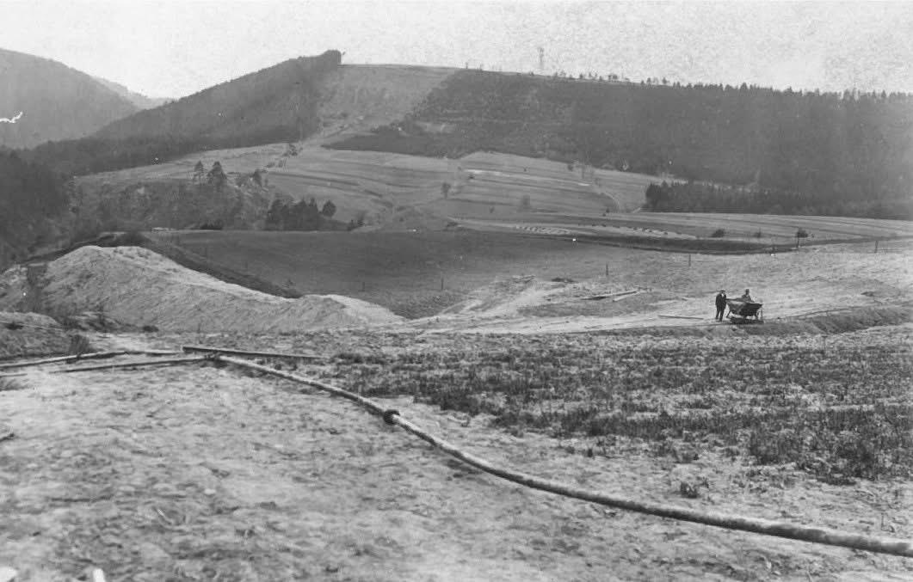
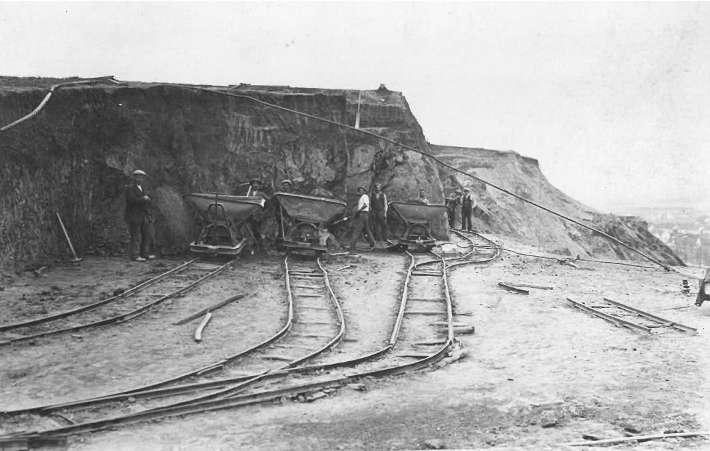
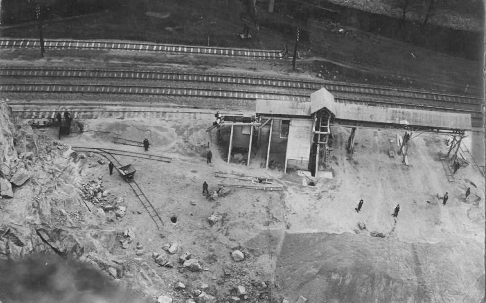
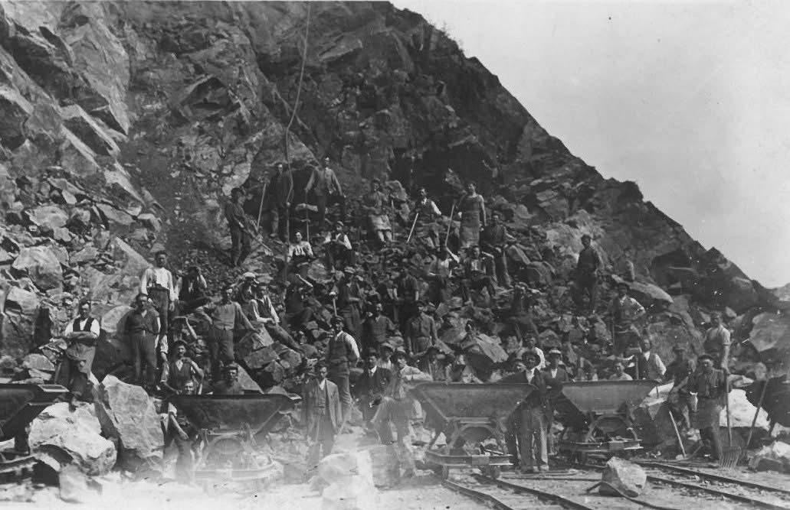
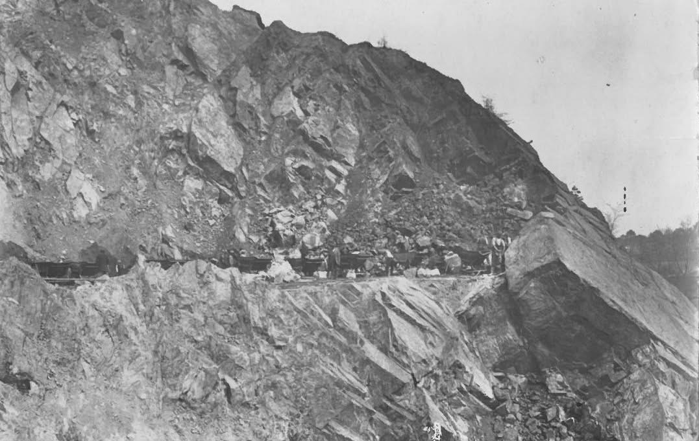
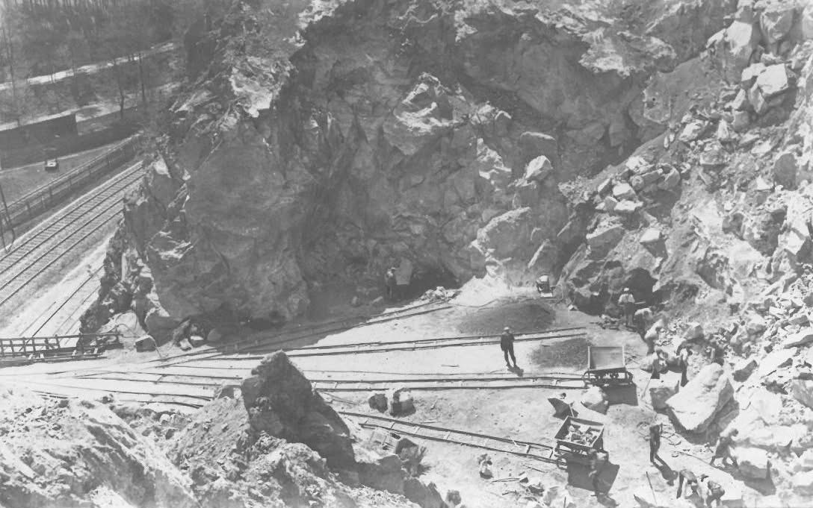
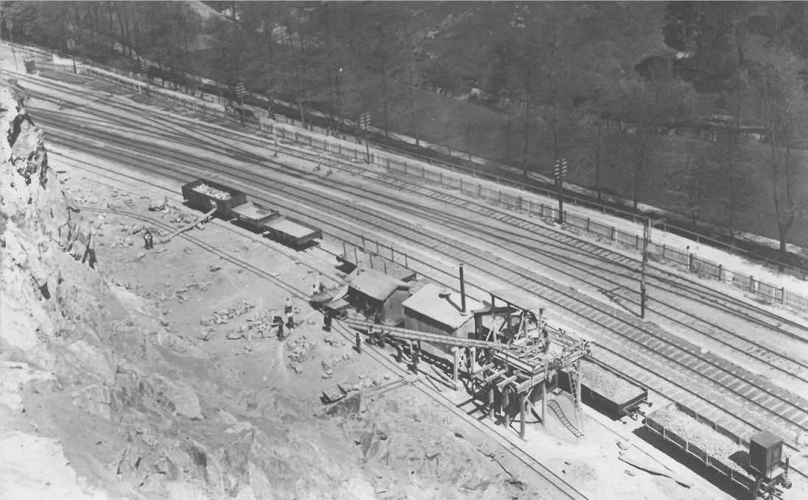
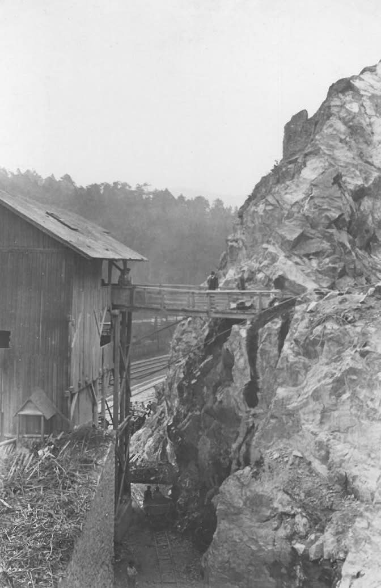
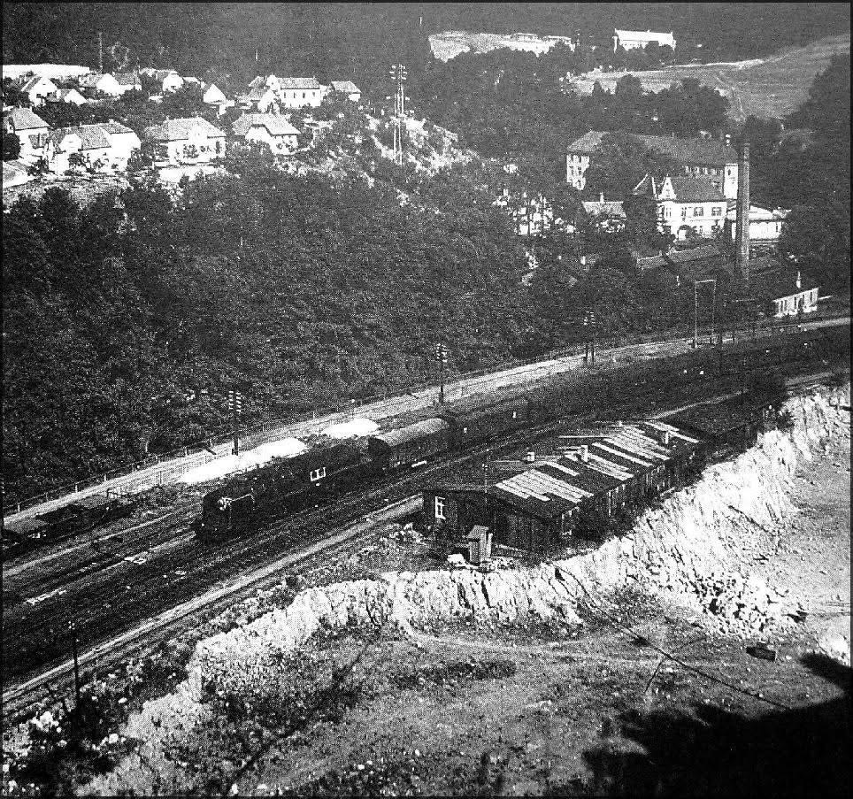

# Kamenolom byl založen roku 1925 a rozšířen v roce 1926. Vlastníkem lomu se stal Milan Vuletič. V 70. letech 20. století byl zatopen vodou, na dně zůstala i důlní technika-vozíky, koleje, zábradlí. Maximální hloubka je osmnáct metrů. Pozemek kolem lomu patřil Českým drahám. Na plot jim chyběly peníze. Jako nepotřebný majetek získal pozemek od Českých drah soukromý majitel.

**List:** Samostatné galerie  
**Trello:** <https://trello.com/c/xuXILXHH/117-kamenolom-byl-zalo%C5%BEen-roku-1925-a-roz%C5%A1%C3%AD%C5%99en-v-roce-1926-vlastn%C3%ADkem-lomu-se-stal-milan-vuleti%C4%8D-v-70-letech-20-stolet%C3%AD-byl-zatopen>  

[← zpět na list](../README.md)

## Přílohy (9)

