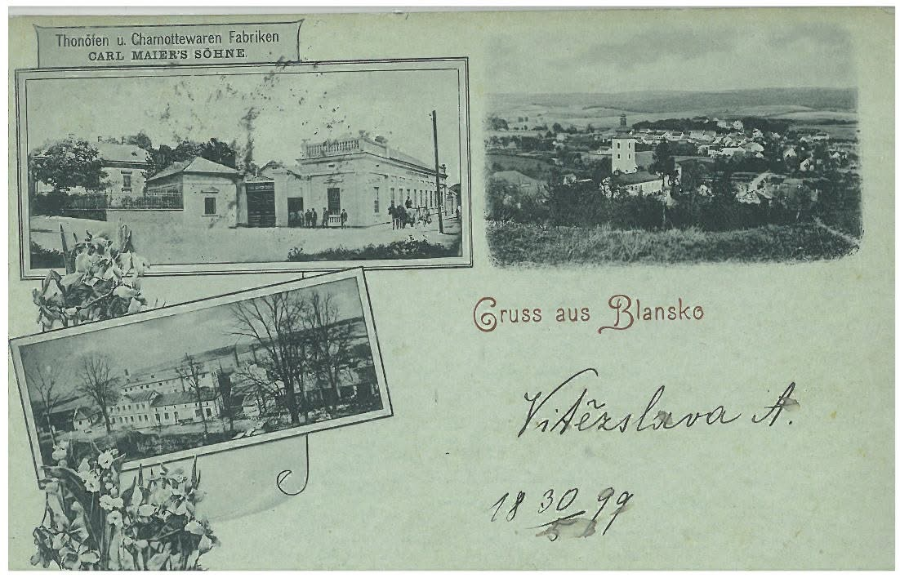
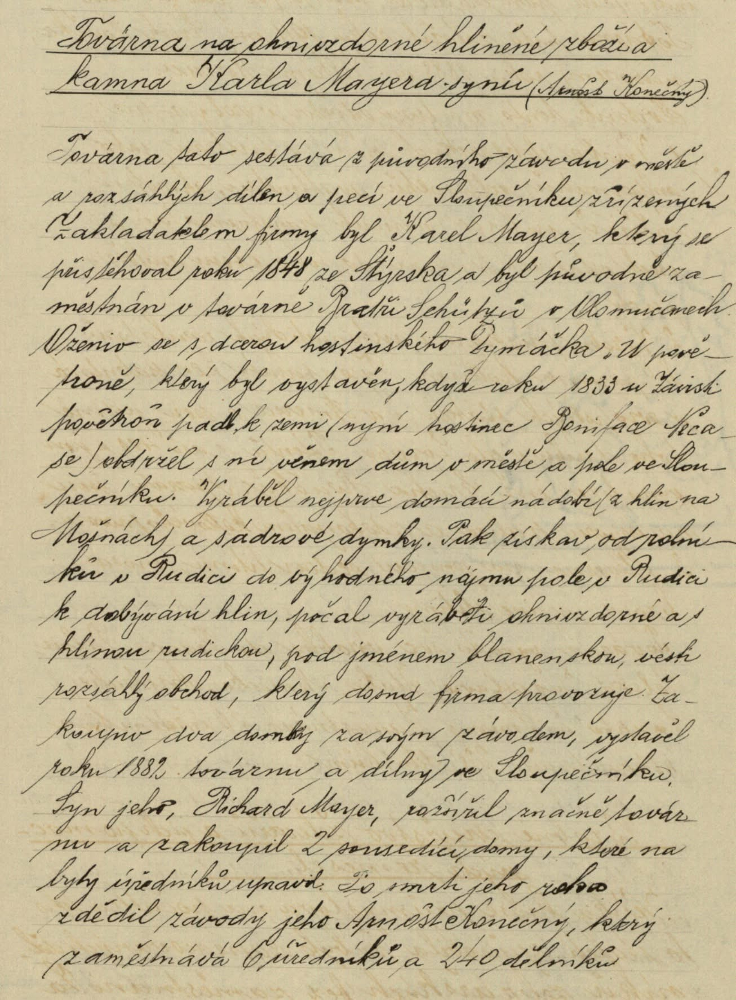
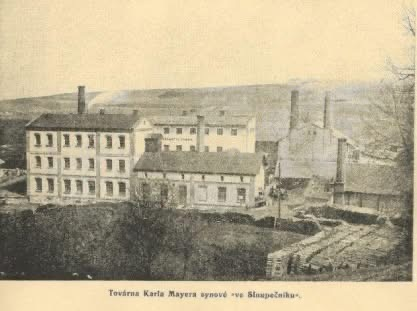

# Karel Mayer a synové

**List:** Samostatné galerie  
**Trello:** <https://trello.com/c/y9CGsRKO/97-karel-mayer-a-synov%C3%A9>  

[← zpět na list](../README.md)

## Popis

BLANSKO HISTORICKÉ. 
KAREL MAYER A SYNOVÉ                                                                        Blansku byla příkladem podnikání firma Karla Mayera a synové – výroba hliněného zboží a těžba ohnivzdorných hlín a vývoz kaolinu. Od roku 1848 byla továrna provozována ve městě (dnešní parkoviště před budovou Všeobecné zdravotní pojišťovny Blansko, Bezručova 220/2). V počátku vyráběla hliněné nádobí a hliněné dýmky. Zboží se vytáčelo na hrnčířském kruhu a hliněné dýmky „gypsonky“ se vytlačovaly do sádrových forem. Kolem roku 1860 tehdejší majitel Karel Mayer postavil druhou vypalovací pec, výhradně na šamotové ohnivzdorné zboží. Postupně hrnčírnu měnil na kamnárnu, která dosáhla  takového rozmachu, že v roce 1865 bylo přikročeno k výstavbě nové továrny v údolí potoka Sloupečník pod lidovým názvem Kamnárna. Od  roku 1869  nese továrna název Carl Mayer. Za dva roky existence byla tato továrna doplněna novými strojními zařízeními a dosavadní nedostačující stroje vyměněny. Po smrti Karla Mayera v roce 1879 dědí firmu synové Karel a Richard a mění ji na veřejnou obchodní společnost, která v roce 1883 nese název továrna  Karla Mayera a synové, výroba hliněného zboží  a těžba ohnivzdorných hlín, Blansko. V roce 1893 se továrna ve Sloupečníku rozšířila o zadní trakt o dvou poschodích. Současně s touto budovou byla postavena další kamnářská pec. Blanenská kamna mají výbornou pověst a zboží bylo dodáváno nejen na Moravu, ale i do ostatních zemí tehdejšího Rakouska-Uherska  i za hranice.  Vyráběla se zde kamna různých druhů a typů. Pro Turecko a část Řecka dodávala továrna nízká orientální kamna, zdobené pestrou ornamentikou, do ostatního zahraničí dodávaly se typy kamen podle rázovitosti každé země. Blanenská kamna vynikala dobrou kvalitou  a dosahovala  vynikající umělecké úrovně zvláště v letech 1904-1914, kdy se vyrábělo majolikové zboží. V době největšího odbytu pracovalo v továrně 240 lidí. Po smrti Richarda Mayera dědí v roce 1915 firmu  Arnošt Konečný. Po válce byla v roce 1945 uvalena na firmu národní správa a v roce 1946 došlo k začlenění továrny Karla Mayera a synové do n. p. Moravské závody kaolinové a hlinné, Blansko.

FB Pavel Svoboda

## Přílohy (3)

