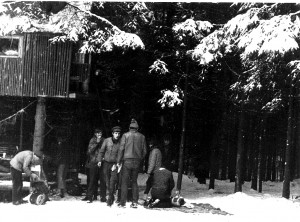
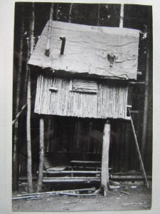
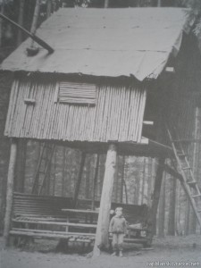
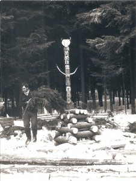

# Medník

**List:** Samostatné galerie  
**Trello:** <https://trello.com/c/sZobGmhZ/14-medn%C3%ADk>  

[← zpět na list](../README.md)

## Popis

https://pavelhnilica.estranky.cz/clanky/mednik-----v-case-temer-ztraceny.html

Camp Medník založil „táta trampingu na Blanensku“, kamarád Meddy (zvaný též Meddy Šakal), pravděpodobně kolem roku 1970 (?).

Dle jeho vyprávění boudu postavili s jeho kamarádem Rolfem, a to na čtyřech stromech, ve výši podlahy asi 2,5 m. To proto, aby byla chráněna před „nevítanými návštěvníky“.

Uvnitř byly 2 palandy, malá kamínka, stolek a u něj 2 sedačky a policová skříňka – vše z kulatiny. Jedno okénko bylo nad stolkem a jedno ve dveřích. Před dveřmi zvenku byla malá plošinka – jako balkónek, o kterou byl opřen žebřík a ze které se vcházelo do boudy.

Druhý žebřík vedl z opačné strany boudy na půdičku, kde se rovněž dalo nocovat (jednou jsem tam spal a byl jsem jako skrčenec a těšil se na ráno, až se zase narovnám ☺).

 

Pod boudou bylo zřízeno posezení – rohová lavice se stolem. Vše bylo rovněž zhotoveno ze smrkových kuláčů, získaných z prořezávky v okolním smrkovém houští.

Před boudou bylo zbudováno velké ohniště pro slavnostní potlachové ohně, kolem něj byly v kruhu dvě řady jednoduchých lavice z kulatiny a „šerifské křeslo“, za nímž stál krásný totem.

Menší ohniště na vaření bylo o něco níže, nedaleko potůčku, na kterém Meddy s Rolfem vybudovali malou přehrádku. Co si vzpomínám, tak v tom potůčku uschovávali i konzervy, byla to taková provizorní chladnička.

Nedaleko byl pramínek, ke kterému se chodilo pro pitnou vodu.

 

Mě na ta místa poprvé zavedl můj dobrý kamarád Dolyk, se kterým jsem se tenkrát, ještě jako žáček ZDŠ ve věku asi kolem 12 roků, toulával po lesích v okolí Blanska. Již tehdy jsme „propadli“ vášni, nazývající se tramping a příroda pro nás byla vším.

A když potom Meddy ještě začal vychovávat nový trampský dorost tím, že v tehdejším Domě pionýrů a mládeže v Blansku otevřel „zájmový kroužek Táborník zálesák“, bylo v našem případě rozhodnuto.

S mými kamarády jsem se zúčastnil na Medníku několika potlachů, které se vždy konávaly kolem února – a byly to akce pouze pro „otrlé zálesáky“. Spalo se tam kde si kdo „ustlal“, tedy povětšině „pod širákem“ – tj. s volným nebem a korunami smrků nad hlavou – a v únoru také jen na pár chvojích na sněhu a pod starou vojenskou celtou. Na potlachy občas zajeli i policajti (orgány VB), aby tam „ty protistátní živly“ zkontrolovali ☺. Trampové jim – a vůbec celému tehdejšímu režimu byli tzv. „trnem v oku“.

Tolik asi z mých vzpomínek. V příloze Ti posílám nějaké fotky a list z mého starého „cancáku“, kam mi Meddy napsal v upomínku pár veršíků. Za kvalitu fotek se omlouvám, lepší jsem nesehnal.

## Přílohy (4)

