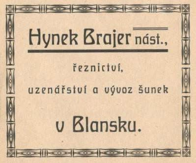
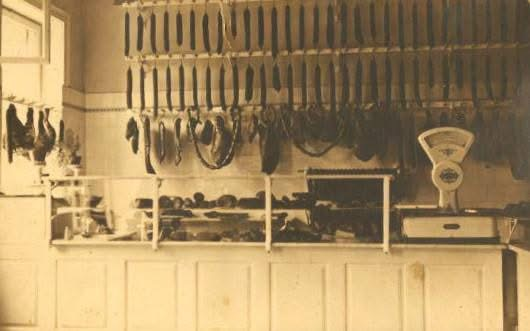
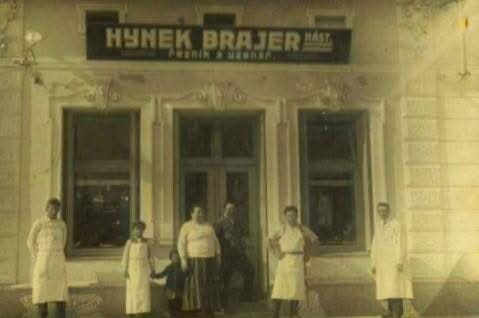

# řeznictví Bayer

**List:** Samostatné galerie  
**Trello:** <https://trello.com/c/CinqjqL7/100-%C5%99eznictv%C3%AD-bayer>  

[← zpět na list](../README.md)

## Popis

BLANSKO HISTORICKÉ.
MOJMÍR BRAJER, ŘEZNICTVÍ A UZENÁŘSTVÍ BLANSKO
Dům na Rožmitálově ulici č.383/28 (dnes Interiérové studio Blansko) koupil v roce 1907 Hynek Brajer, řezník a hospodský původně z Rudice. Jeho syn Mojmír dojížděl do Brna   na reálné gymnázium na Křenové ulici. Na území Rakouska-Uherska neexistovala vyšší uzenářská škola, proto odjel Mojmír studovat do Lipska. Učivo nezahrnovalo jen výrobu uzenin, ale např. také poměrně rozsáhlé informace o chovu a nemocech hospodářských zvířat. Jediným dalším českým spolužákem byl Cyril z Prahy, se kterým Mojmíra vázalo silné přátelské pouto. To se ještě prohloubilo, když museli po vypuknutí první světové války narukovat. Společně se přihlásili na kurz boje s bajonety a v bojích v Itálii byli ve stejné jednotce. Cyril zachránil Mojmírovi život, svým střelným zraněním bohužel Cyril podlehl. Roku 1916 zemřel tatínek Hynek a Mojmír se vrátil z války, aby převzal vedení rodinné firmy.
Vznik první republiky jako vlastenec s vášnivým zájmem o politiku vítal, nicméně jako mnoho jiných živnostníků utrpěl finanční ztráty. Radost do života mu přinesla Marie, se kterou se oženil roku 1921. Marie měla vystudovanou střední školu pro ženská povolání 
a manželovi byla velkou a velmi schopnou oporou. Společně dům s řeznictvím zvelebili, přistavěli udírnu a chladírnu.
      V 30. letech byl Mojmír v představenstvu Moravské hospodářské komory. V podnikání se mu dařilo, uzeniny neprodával jen v Blansku a okolí, díky umístění v blízkosti vlakové zastávky salámy dovážel do Pardubic a do Prahy pražskou šunku, na kterou nechával speciálně vykrmovat prasata u místních hospodářů. Oblast, ve které  Mojmírovi život nepřál bylo zdraví. Začal mít problémy se srdcem, které ho omezovaly v osobním i profesním životě. V roce 1948 byla jeho udírna zapečetěna a prodejnu převzal národní podnik Masna, kde oba manželé zůstali zaměstnáni, Mojmír až do své smrti v roce 1960.
Oproti jiným živnostníkům měli manželé Brajerovi to štěstí, že mohli dožít ve svém. Ačkoli sledovat, jak o něčem, co sami vybudovali rozhodují cizí lidé bylo především pro Mojmíra velmi bolestivé.

## Přílohy (3)

