# Školy v Blansku

**List:** Samostatné galerie  
**Trello:** <https://trello.com/c/cyt8kNh3/103-%C5%A1koly-v-blansku>  

[← zpět na list](../README.md)

## Popis

BLANENSKÉ ŠKOLY
První škola se nacházela na farském dvoře již v roce 1600.

Foto první : Škola na Starém Blansku byla v provozu v domě č.64 do roku 1804.

Foto druhé: V roce 1804 byla postavena nová školní budova na Starém Blansku č. 139.

Třetí a čtvrtá fotografie: V roce 1897 byla postavena nová školní budova na Školní, dnešní Seifertově ulici (Gymnázium Blansko).

Fotografie pátá, šestá. sedmá : Velkým kulturním počinem bylo postavení rozsáhlé a impozantní budovy Masarykovy měšťanské školy v letech 1927- 1928.
V roce 1977 k ní bylo přistaveno stravovací zařízení.

Fotografie osmá a devátá: V roce 1964 byla předána do užívání ZŠ v Blansku na Dvorské ulici.

Fotografie desátá a jedenáctá: 1. září 1982 byla předána veřejnosti do užívání  nová 18třídní ZŠ Terrerova, dnešní ZŠ na Salmově ulici.

Fotografie dvanáctá: 30. září 1956 byla předána do užívání jedenáctiletka na ulici Erbenově.

## Přílohy (12)

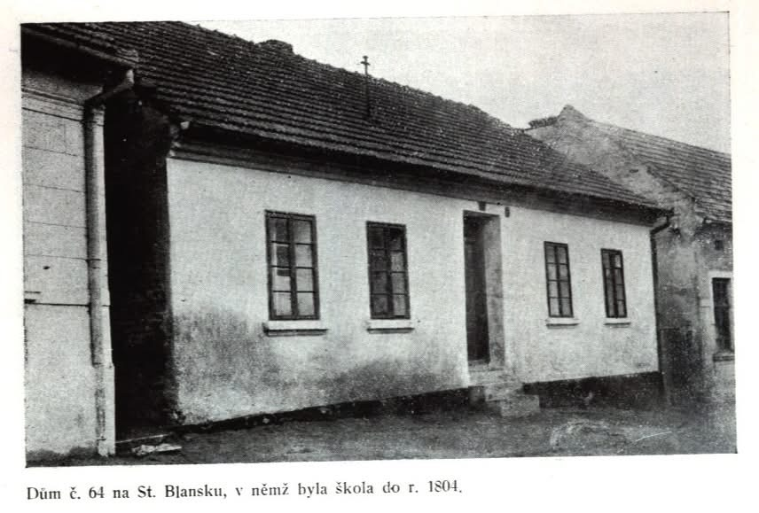

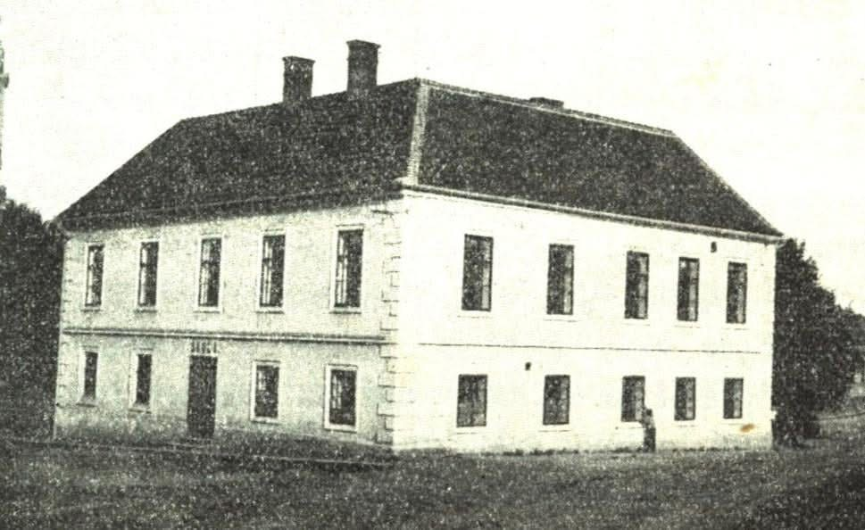

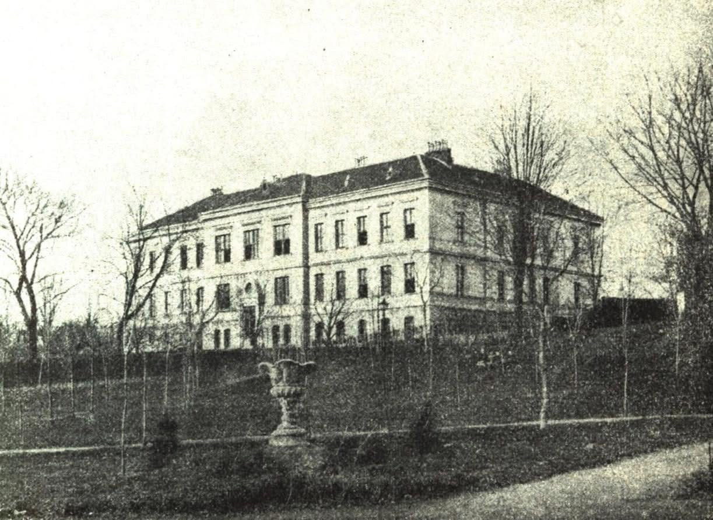

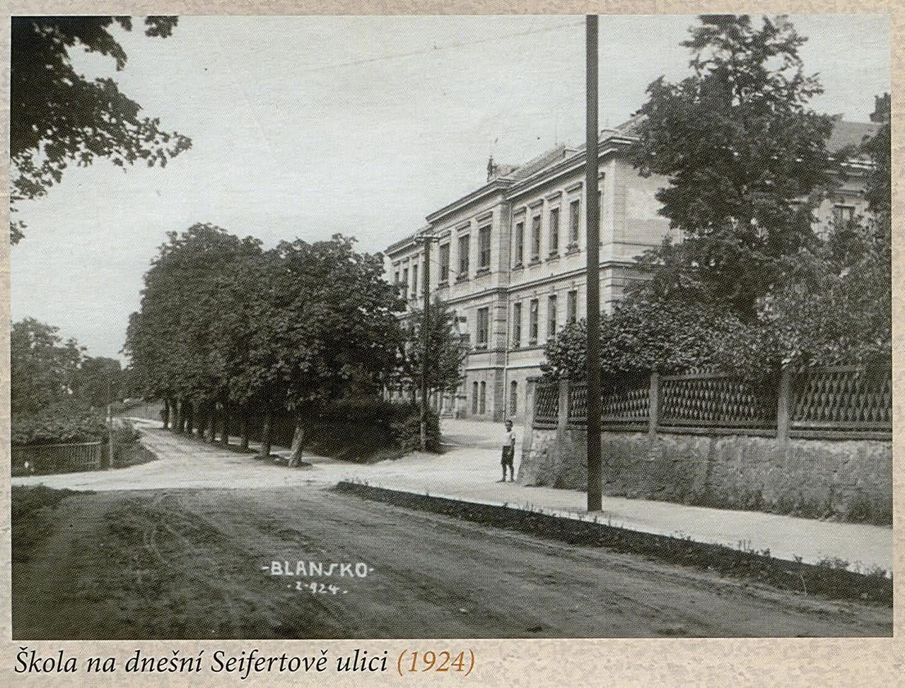

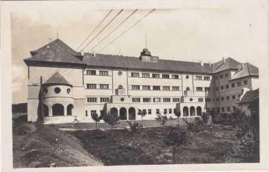

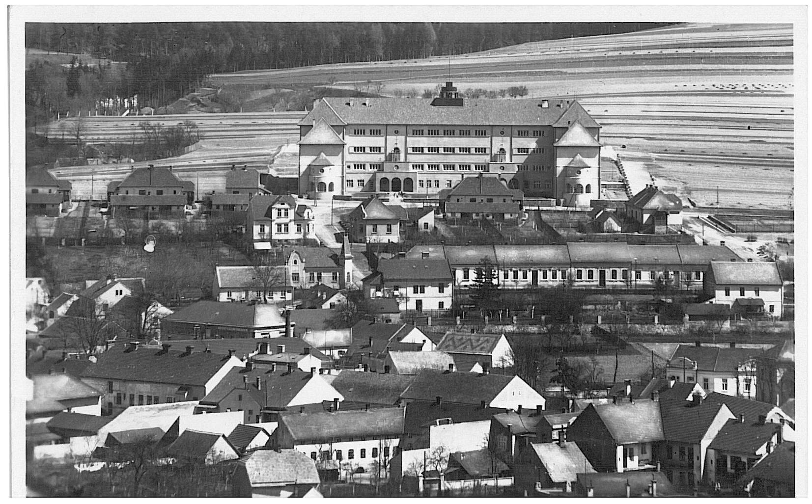

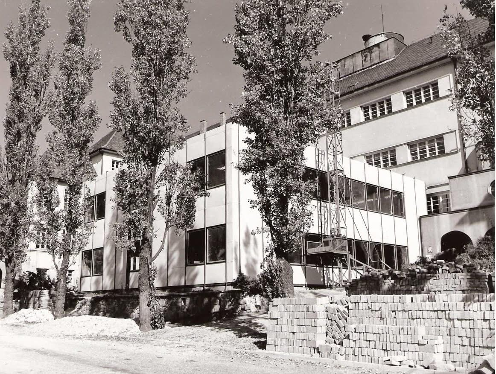

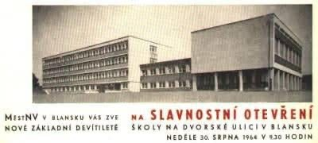

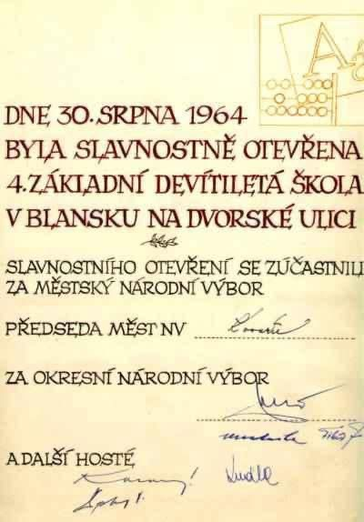

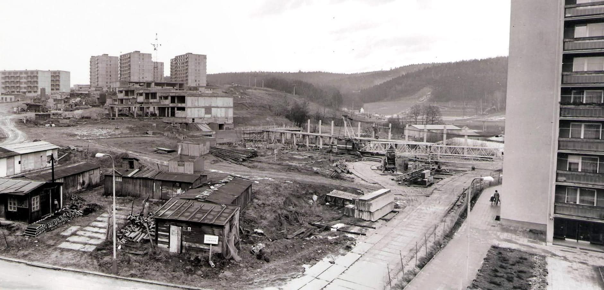

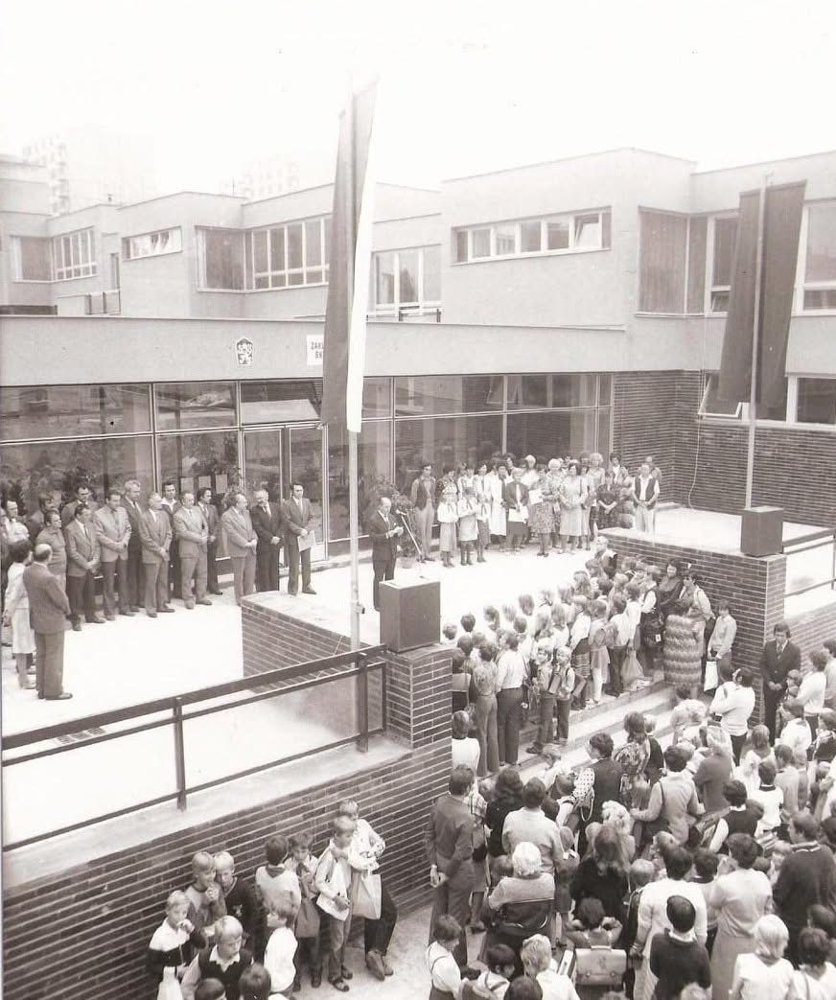

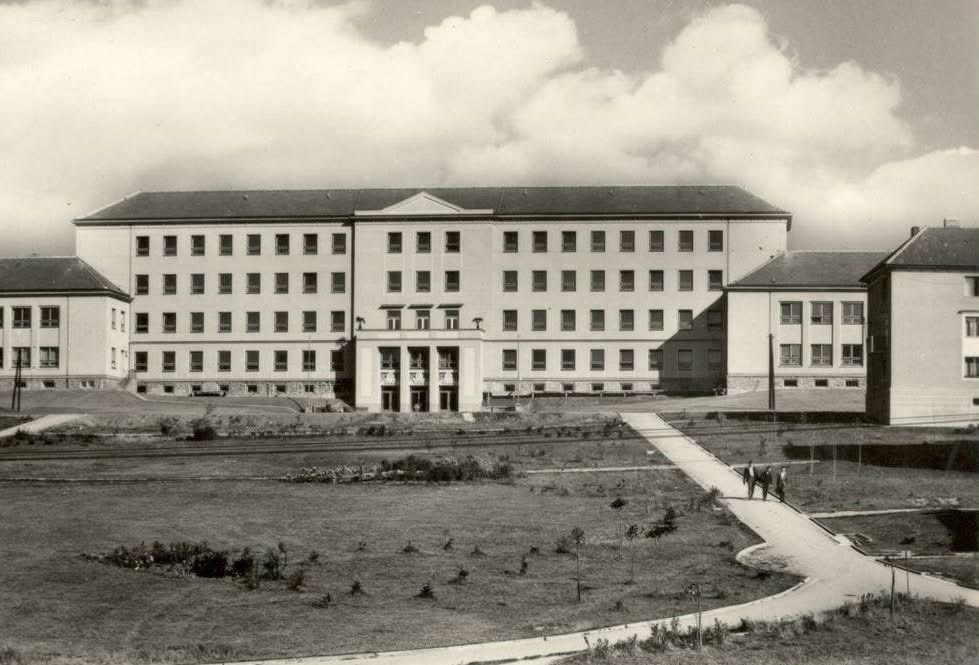
