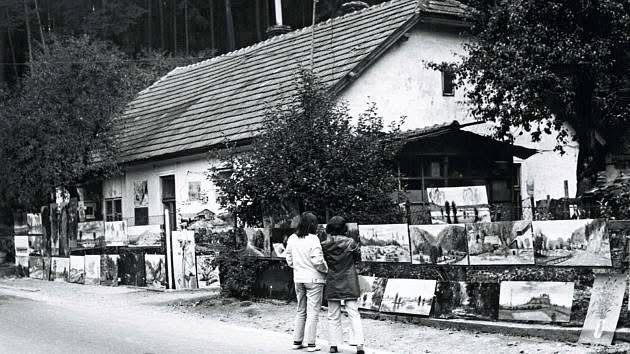
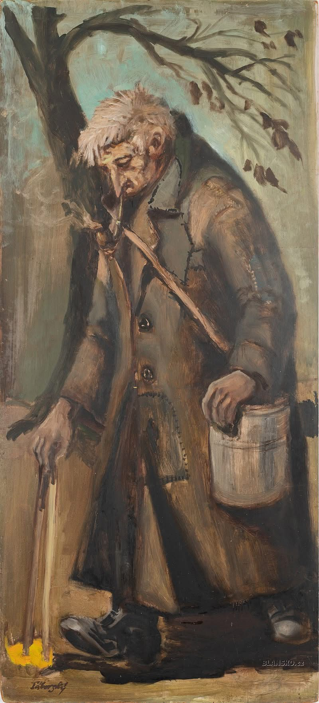
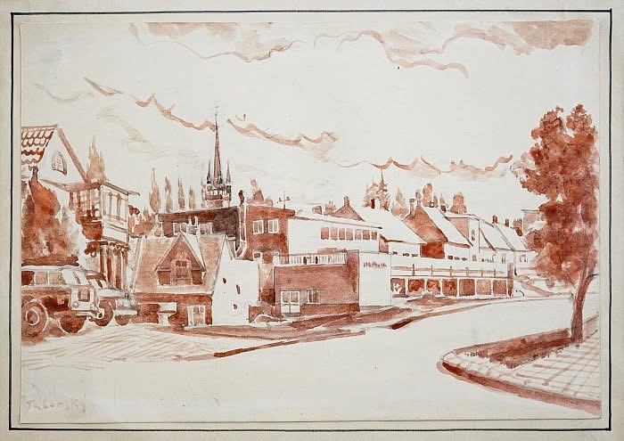
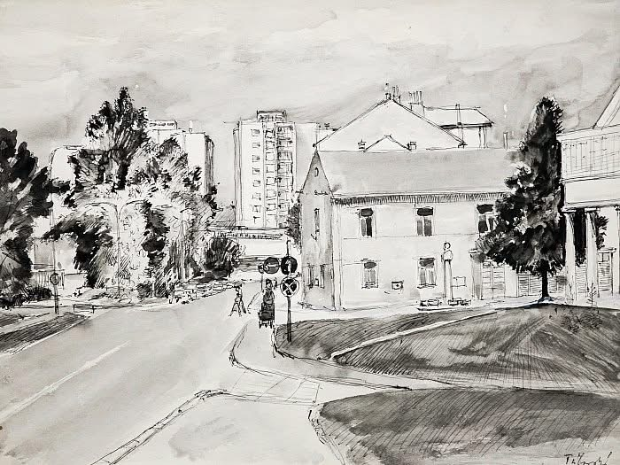
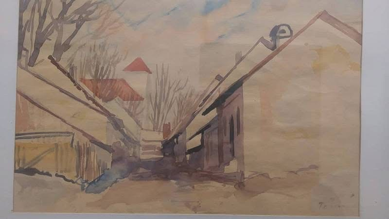
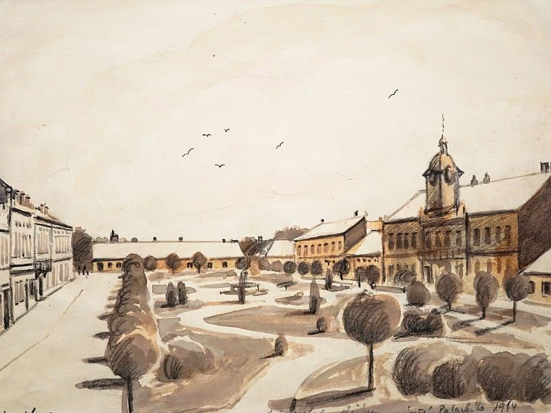
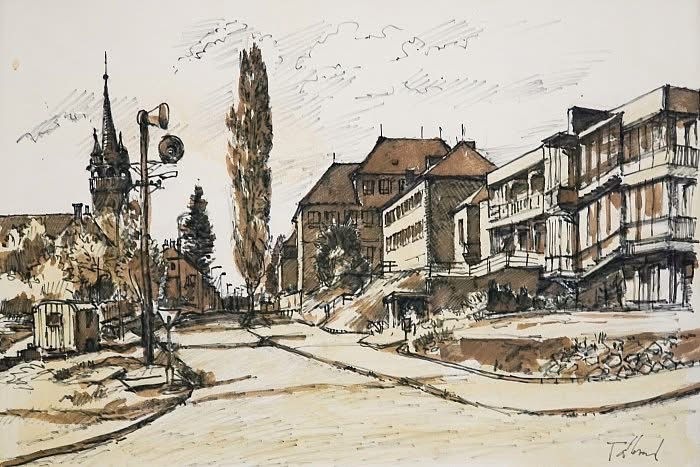
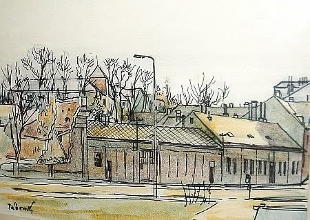
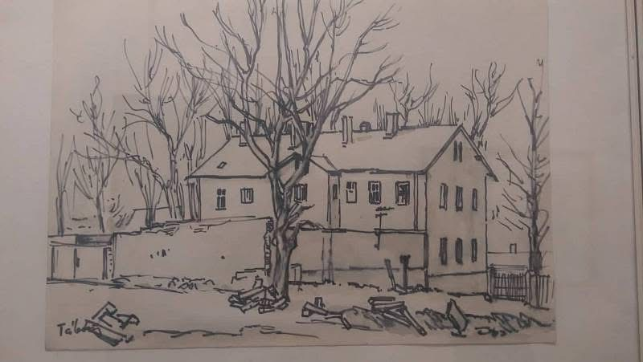

# Vzpomínka na Zdenka Táborského

**List:** Samostatné galerie  
**Trello:** <https://trello.com/c/fDbeSFKw/101-vzpom%C3%ADnka-na-zdenka-t%C3%A1borsk%C3%A9ho>  

[← zpět na list](../README.md)

## Popis

VZPOMÍNKA NA ZDEŇKA TÁBORSKÉHO

Druhého února 1992 převezl Cháron na druhý břeh řeky Styx pozoruhodného, originálního a dosud opomíjeného blanenského malíře, samouka Zdeňka Táborského. 

V roce 1955 absolvoval ve Zlíně obchodní školu, pracoval pak zprvu v reklamním oddělení, poté v návrhárně obuvních doplňků. Později pracuje jako řemeslník v adamovské továrně.
Dvakrát mu bylo nabídnuto studium na pražské Akademii výtvarných umění u profesora Otakara Španiela a později u profesora Jaroslava Gruse. Finančně náročné studium však vždy odmítl a horlivě pokračoval v individuálním sebevzdělávání.
Dobrý malíř, vynikající kreslíř na svých obrazech zachytil převážně přírodu Blanenska, zejména Moravského krasu. Zaujaly ho také motivy ze starého a nového Blanska. Částí své tvorby se ujal role kronikáře, který prostřednictvím nekonečné řady kreseb vydává svědectví o stavebních a urbanistických proměnách města Blanska.
 Osvědčil se jako pohotový kreslíř, zvládl techniku kresby tuší, tužkou, rudkou, pastelem či akvarelového štětce.
Na veřejnosti byl znám především svojí „Galerií na plotě“ (při silnici ze Svaté Kateřiny do Blanska) a obrazem „Vojtíška napaty“.
Zdeněk Táborský měl dvě velké dlouholeté lásky. Malování a literární tvorbu. Vždy, když se setkaly v pravém okamžiku, ať na plátně či listu papíru, vznikla z toho vroucí výpověď – „Poezie v obrazech, obrazy v poezii“. 

Buď sbohem, řeko má, zas zítra na shledanou, až nový den dá barvy do tvých dlaní, já přijdu zas, jak pytlák na čekanou zachytit krásu tvou v oparu za svítání. (Zdeněk Táborský, Svitavě).

## Přílohy (9)

