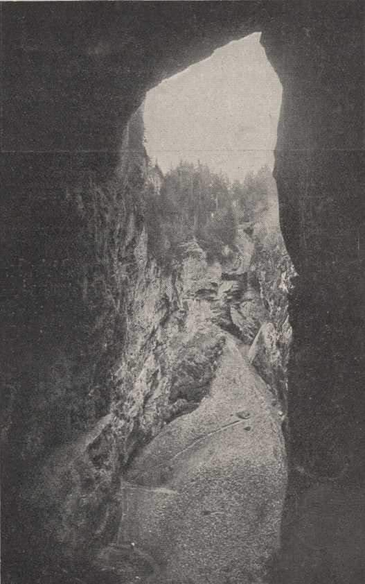
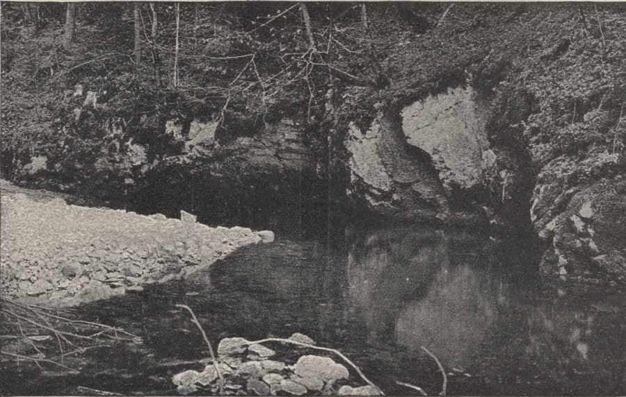
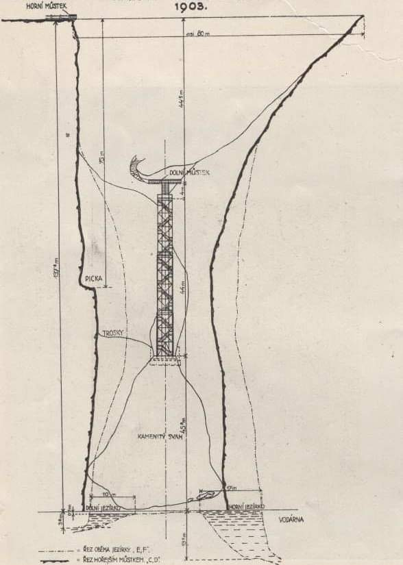

# Macocha

**List:** Moravský kras  
**Trello:** <https://trello.com/c/fu1CvHVE/52-macocha>  

[← zpět na list](../README.md)

## Popis

Macocha počátkem 20. let.
1. Pohled na Macochu z Pekelného jícnu
2. Spodní výtok Punkvy
3. Příčný řez Macochou a návrh na schodiště z roku 1903. Kreslil   Rudolf Dembovský.

https://www.facebook.com/groups/blanenstaci/permalink/1248477749170829/

## Přílohy (3)

