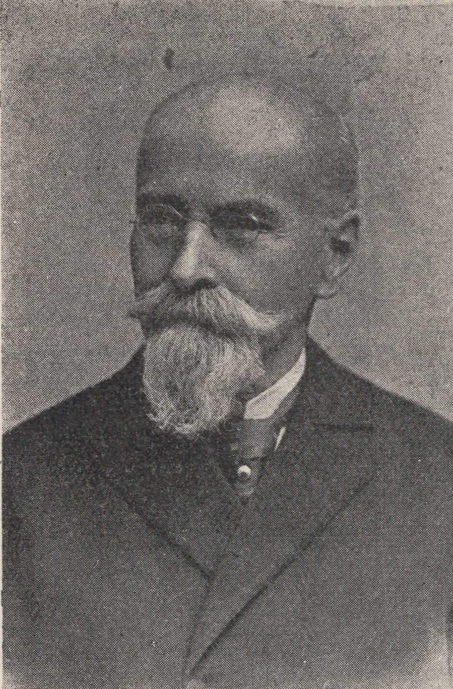
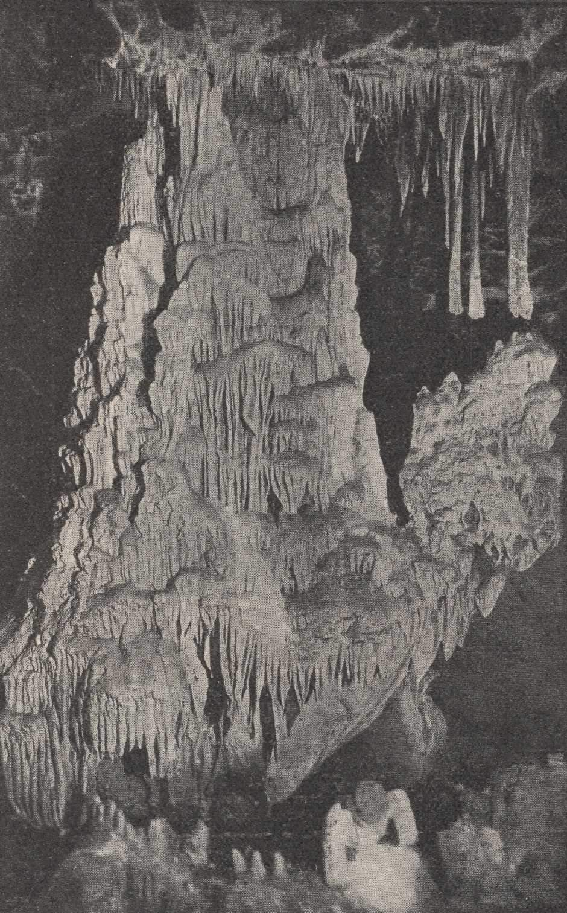
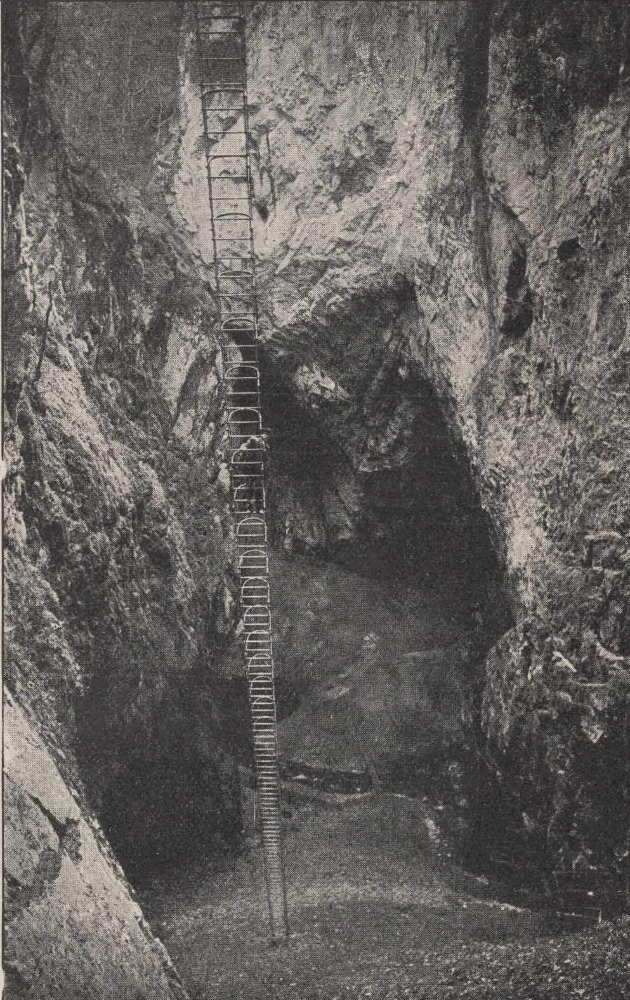
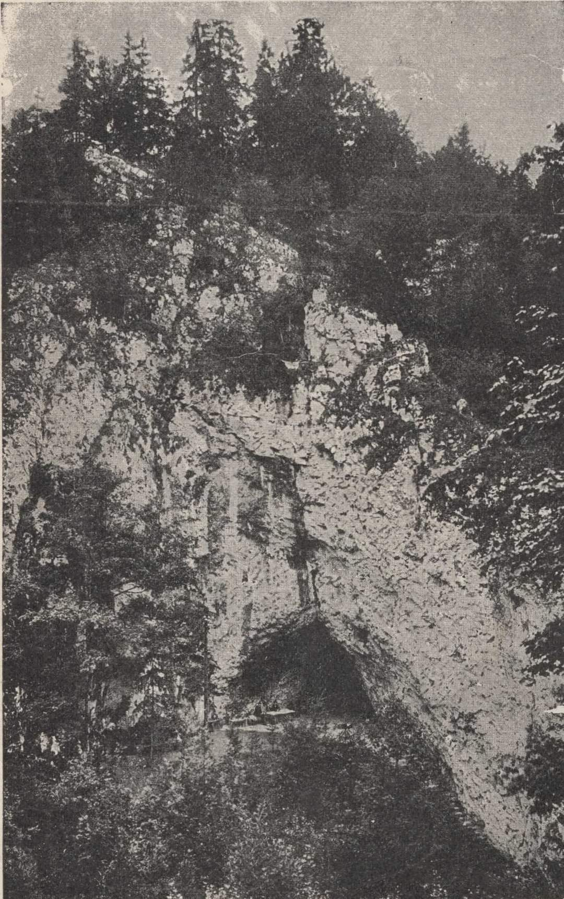
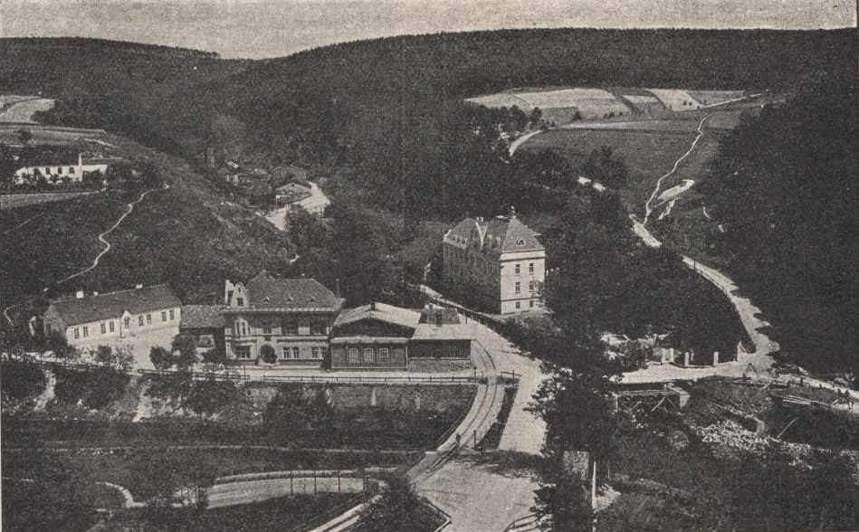

# Mk

**List:** Moravský kras  
**Trello:** <https://trello.com/c/8TyrEPao/32-mk>  

[← zpět na list](../README.md)

## Popis

https://m.facebook.com/groups/blanenstaci/permalink/1222918185060119/

Moravský kras v roce 1921.
1. Soutok Punkvy se Svitavou v Blansku
2. Horní výtok Punkvy
3. Hlavní stěna Macochy
4. Velký krápníkový útvar v Punkevní jeskyni
5. Badatel Moravského krasu 19. století Dr. Kořistka.

mirko Večeř

## Přílohy (5)

