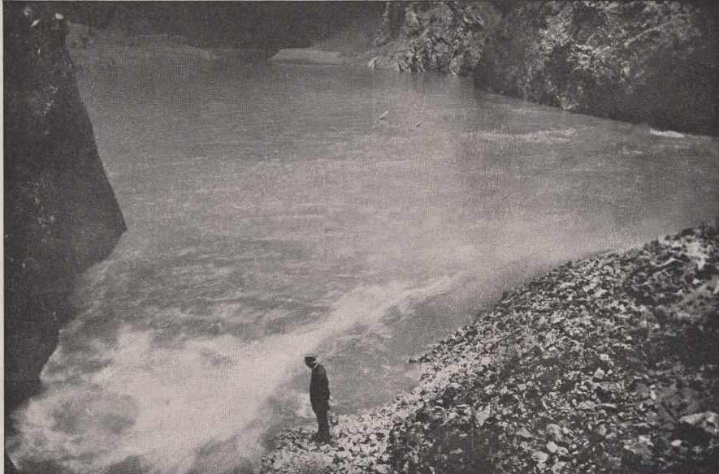

# Mk

**List:** Moravský kras  
**Trello:** <https://trello.com/c/BzYbRA9o/35-mk>  

[← zpět na list](../README.md)

## Popis

https://www.facebook.com/groups/blanenstaci/permalink/1210876752930929/

Dne 16. dubna 1917 se nad Moravským krasem přehnala obrovská průtrž mračen, která nebyla v té době pamětníky popsána. Vodní příval od Protivanova zaplavil celé Sloupské údolí a zmizel v podzemí. Za dvě hodiny se masy vod vřítily na dno Macochy. Na obrázku je vidět divoký přítok z neznámých koryt a zaplavu na dně propasti. V levém dolním rohu je obrovský vodní vír, který vodu pohlcoval a odváděl k Punkvě. Divoké vody, spoutané skálami poskytovaly nepochybně nevšední podívanou.

## Přílohy (1)

