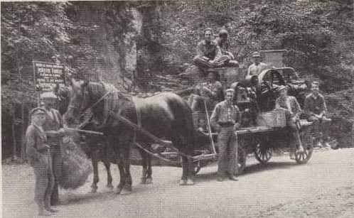
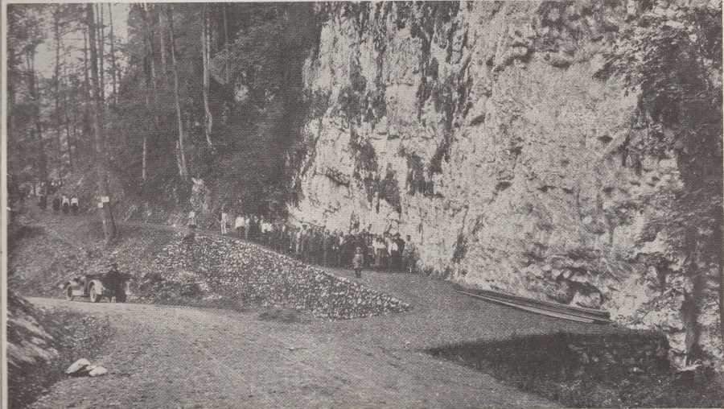
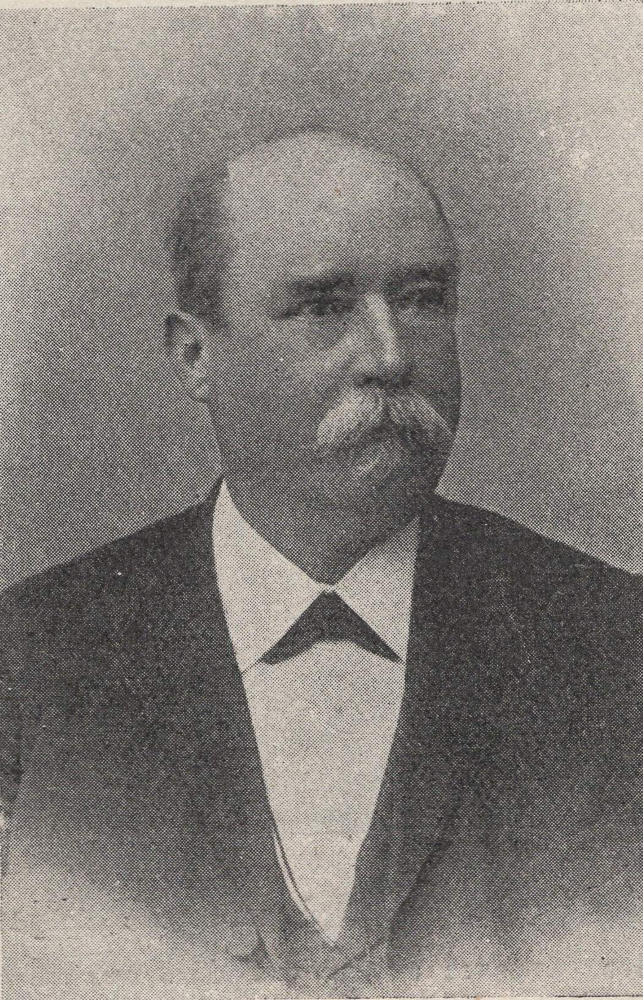

# Mk

**List:** Moravský kras  
**Trello:** <https://trello.com/c/GLTZV0Es/49-mk>  

[← zpět na list](../README.md)

## Popis

Macocha 1922
1. Ingersollův vrtací stroj
2. Salmova stezka otevřená 16. července 1922
3. Krasový badatel Dr. Martin Kříž.

https://m.facebook.com/groups/blanenstaci/permalink/1238629546822316/

## Přílohy (3)

