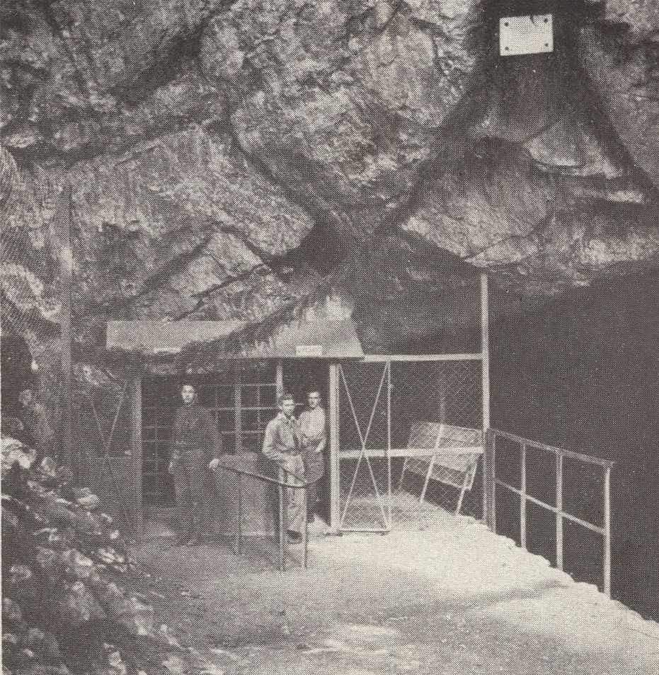
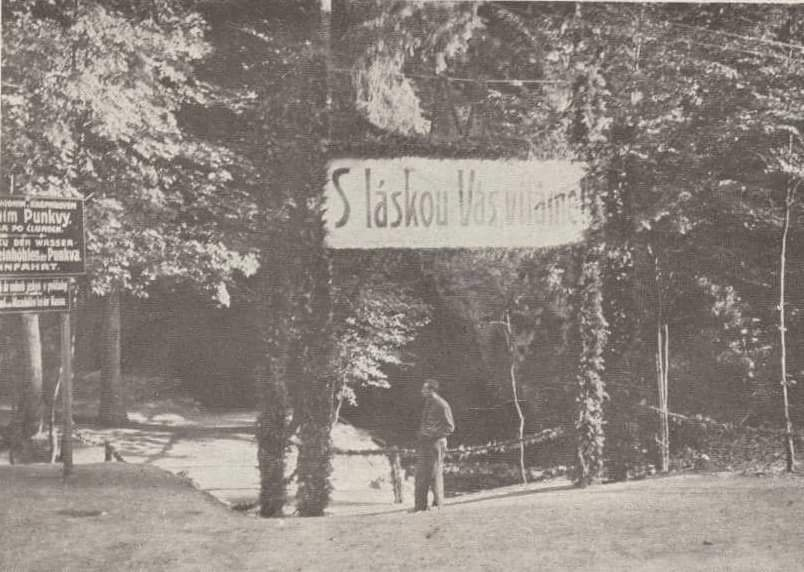
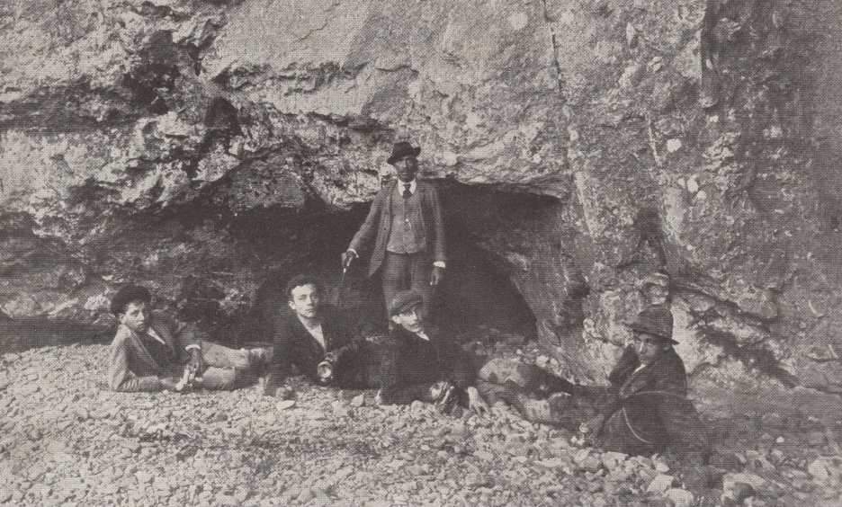
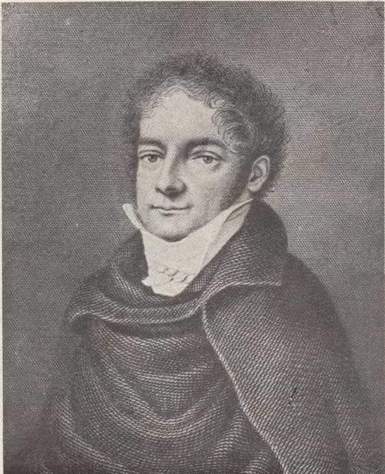

# Mk

**List:** Moravský kras  
**Trello:** <https://trello.com/c/Ke0Hcfzo/33-mk>  

[← zpět na list](../README.md)

## Popis

https://www.facebook.com/groups/blanenstaci/permalink/1218466975505240/

Průzkum Moravského krasu.
Průkopník krasového bádání Hugo Salm (1800 - 1836)
Výzkumná skupina z roku 1900 u Sloupského potoka
Před Punkvou v den návštěvy presidenta T. G. Masaryka 17. září 1921
Vstup do podzemí Punkvy.

## Přílohy (4)

