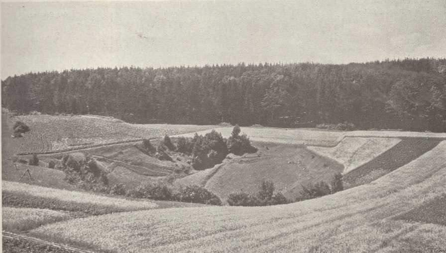
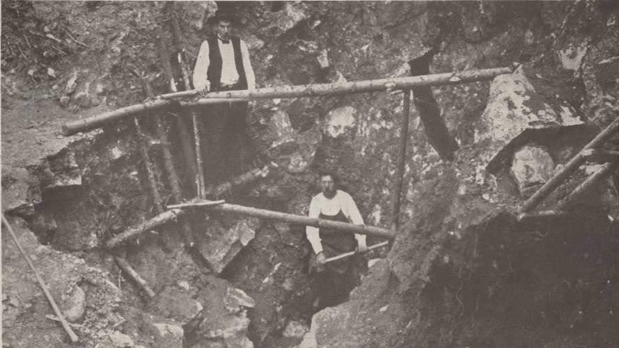
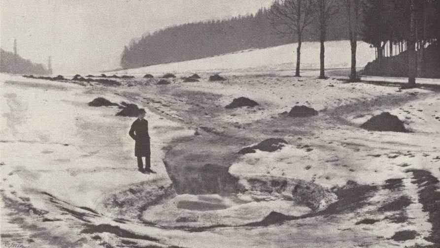
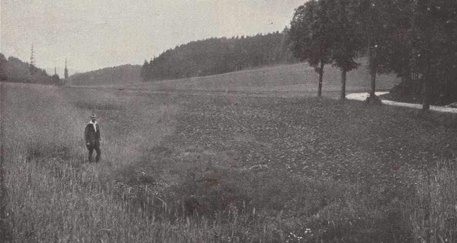

# MK

**List:** Moravský kras  
**Trello:** <https://trello.com/c/XN0elYc6/36-mk>  

[← zpět na list](../README.md)

## Popis

1. Závrt Městikáď
2. Pokus o otevření závrtu Městikáď v roce 1914
3. - 4. Neznámý závrt koncem zimy (závrt hltá spoustu vody) a na 
          jaře 1922.

https://m.facebook.com/groups/blanenstaci/permalink/1232896610728943/

## Přílohy (4)

