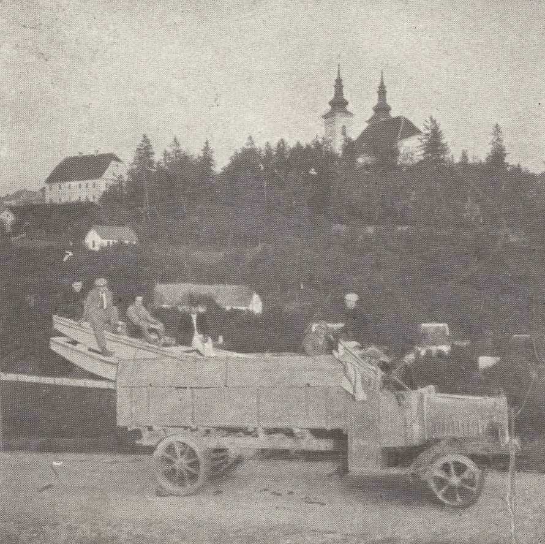
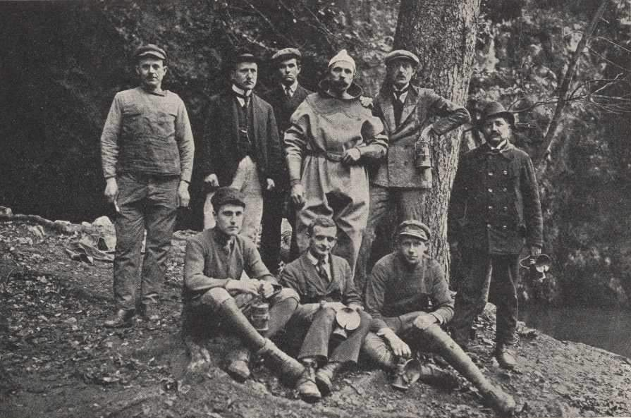
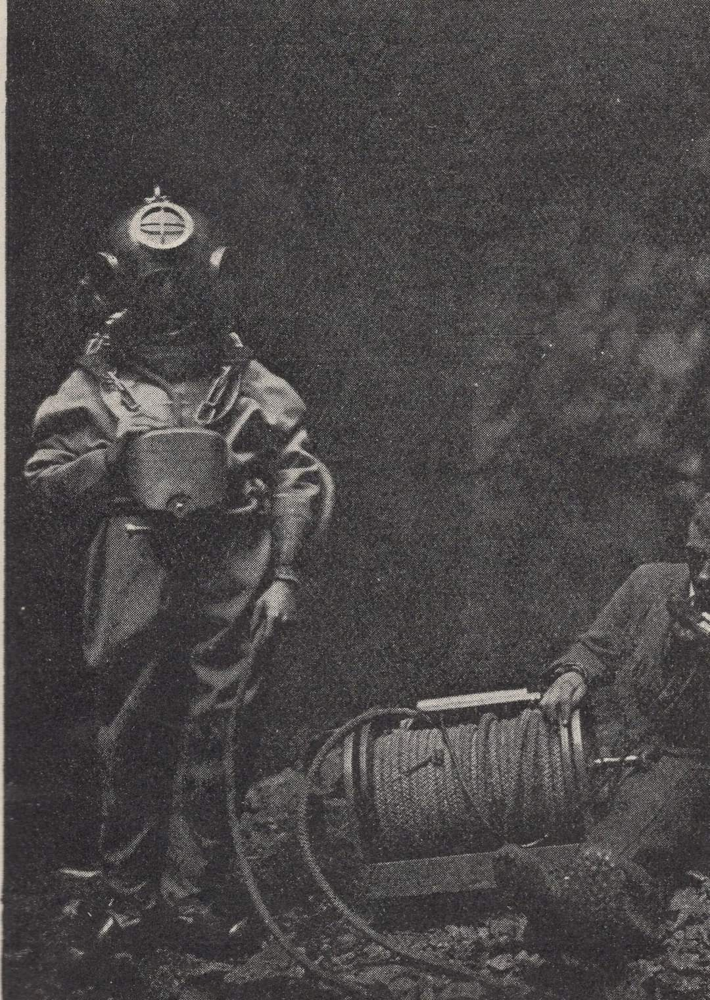
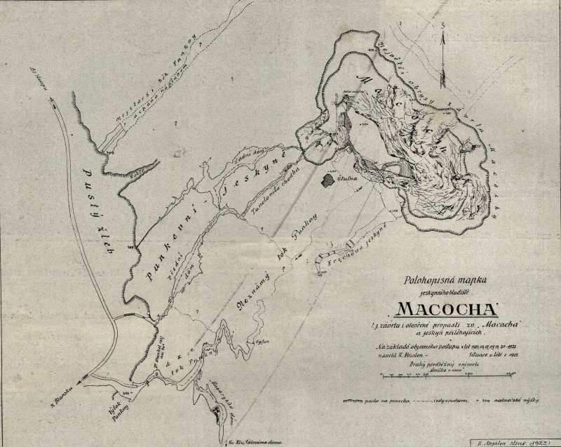
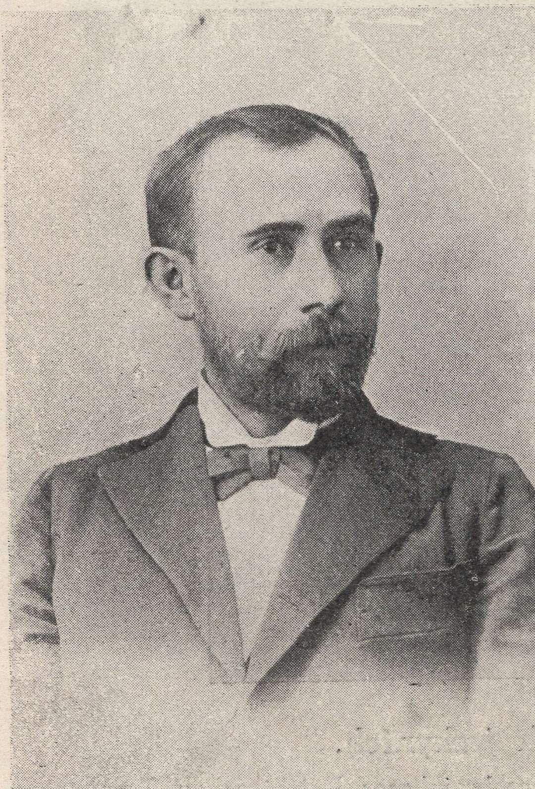

# Mk

**List:** Moravský kras  
**Trello:** <https://trello.com/c/l0O2NYV5/47-mk>  

[← zpět na list](../README.md)

## Popis

1. Nákladní auto přiváží z Brna čluny do podzemí Punkvy. V pozadí obec Vranov.
2. Výzkumná skupina na Macoše. Uprostřed potápěč Buršík.
3. Potápěč Buršík
4. Mapka Macochy z roku 1922
5. Adolf Podroužek výzkumník Macochy v roce 1894.

https://m.facebook.com/groups/blanenstaci/permalink/1235561100462494/

## Přílohy (5)

