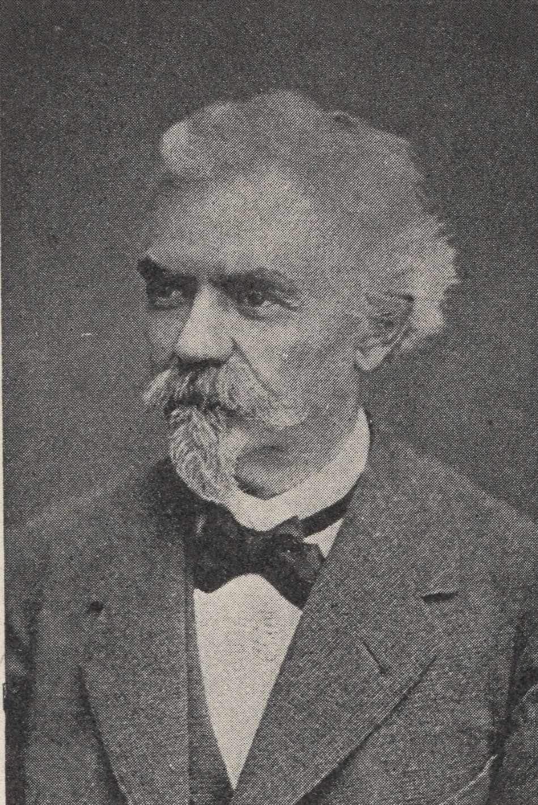
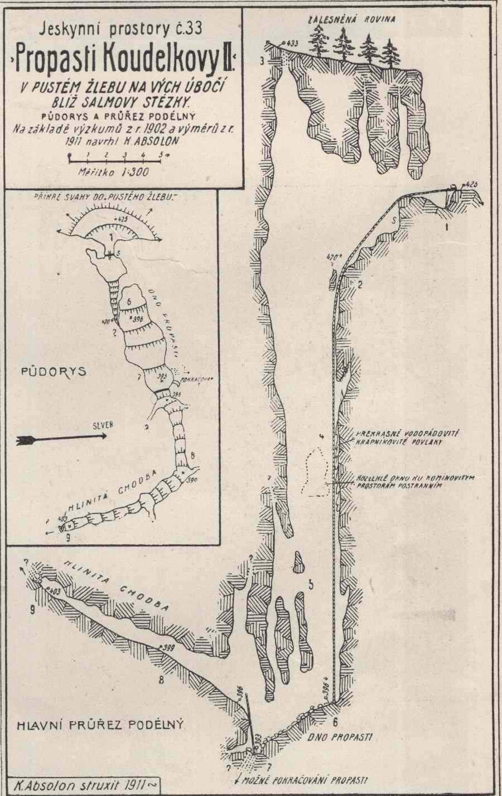
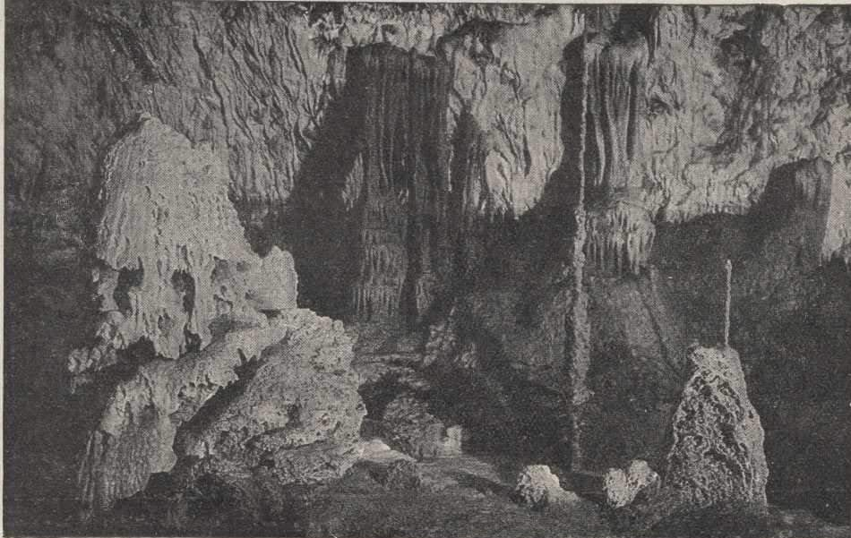
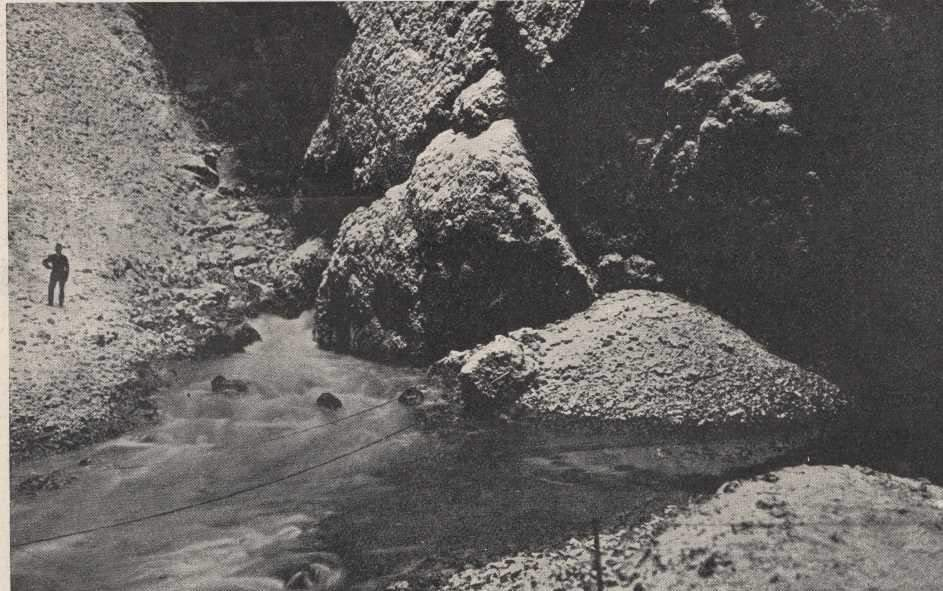
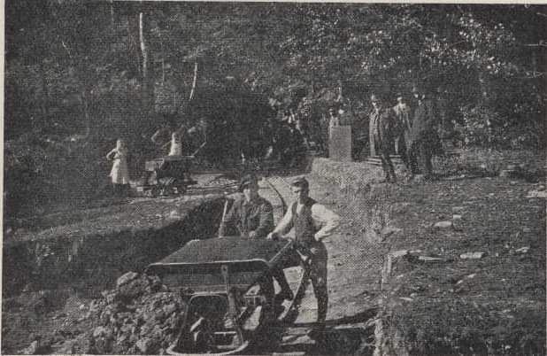
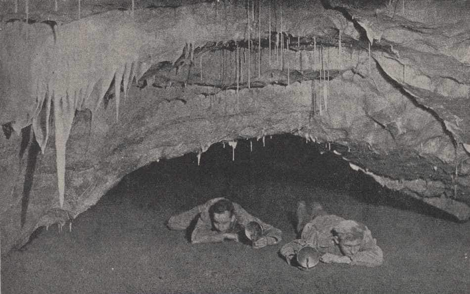

# Mk

**List:** Moravský kras  
**Trello:** <https://trello.com/c/nj50iXi3/31-mk>  

[← zpět na list](../README.md)

## Popis

https://m.facebook.com/groups/blanenstaci/permalink/1229284444423493/

Moravský kras v roce 1921.
1. Dobývání fosforečných hnojiv z jeskyně Výpustek
2. Průzkum nových jeskyní
3. Vodní přítok do Macochy
4. Punkevní jeskyně
5. Mapa jeskynních prostor
6. Spolupracovník Wankelův kartograf A. Mládek.

## Přílohy (6)

