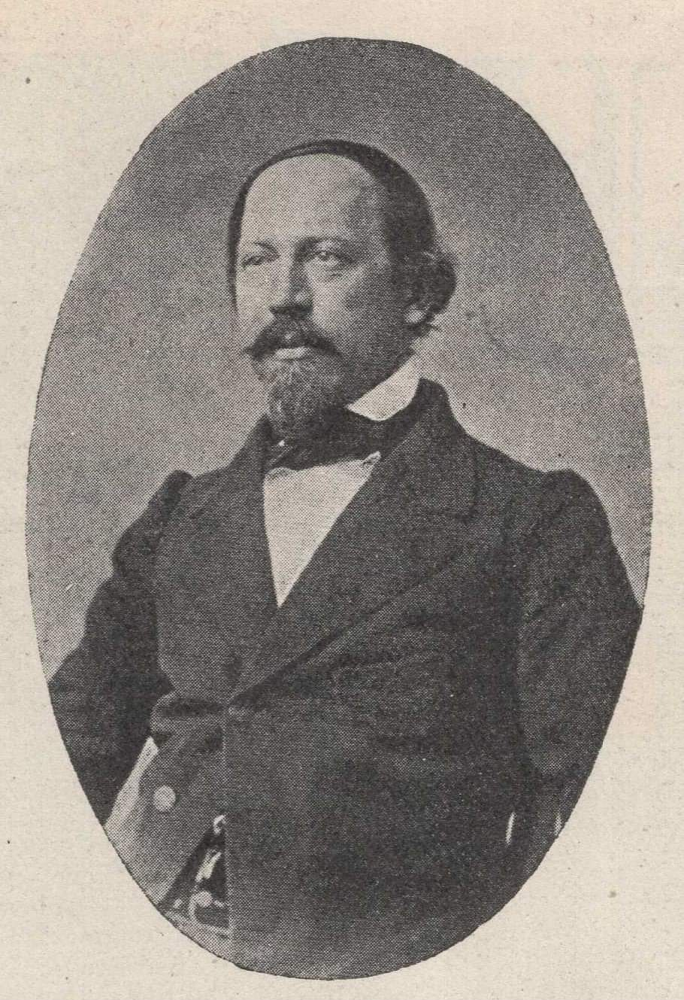
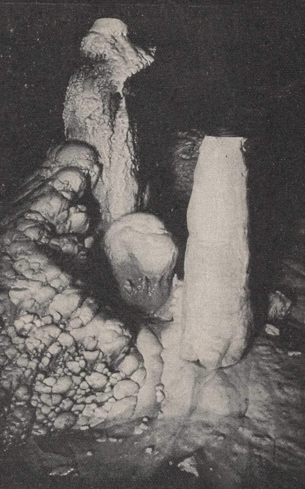
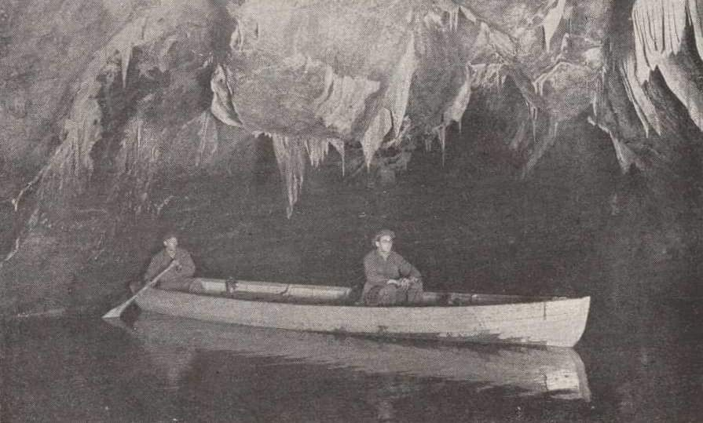
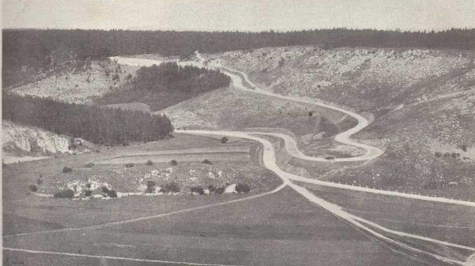
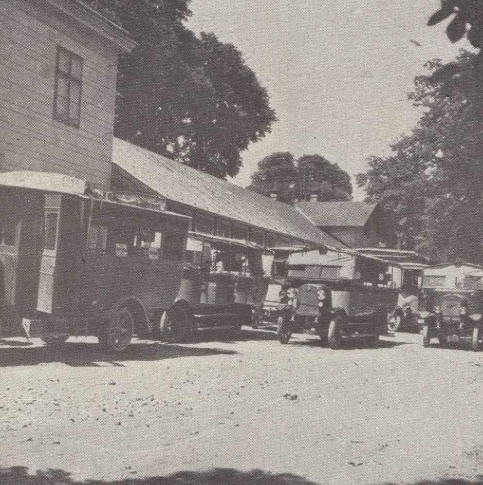

# Moravský kras

**List:** Moravský kras  
**Trello:** <https://trello.com/c/nlDal3Ta/30-moravsk%C3%BD-kras>  

[← zpět na list](../README.md)

## Popis

Moravský kras v roce 1922
1. Autobusy v Blansku na vlakovém nádraží čekají na návštěvníky Moravského krasu
2. Stavba přístupových silnic k Macoše
3. Průzkum Punkevní jeskyně
4. Krápníky v Punkevní jeskyni.
5. Badatel Moravského krasu dr. Wankel.

https://m.facebook.com/groups/blanenstaci/permalink/1226073991411205/

## Přílohy (5)

