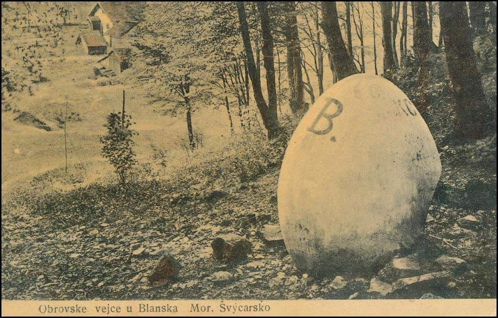
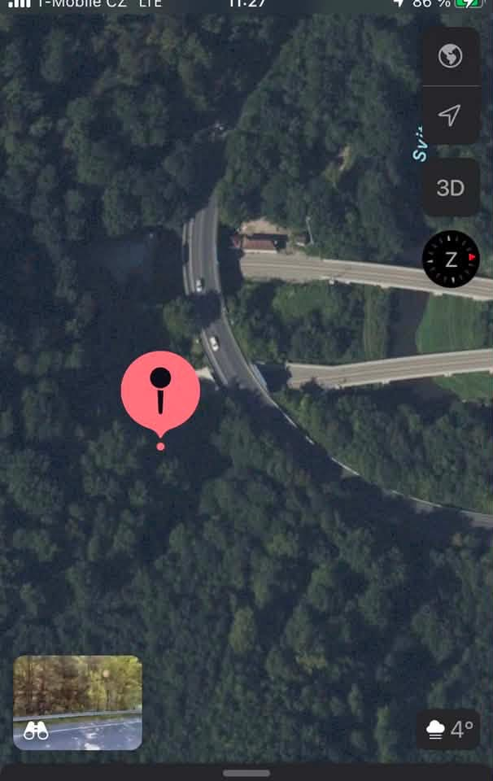
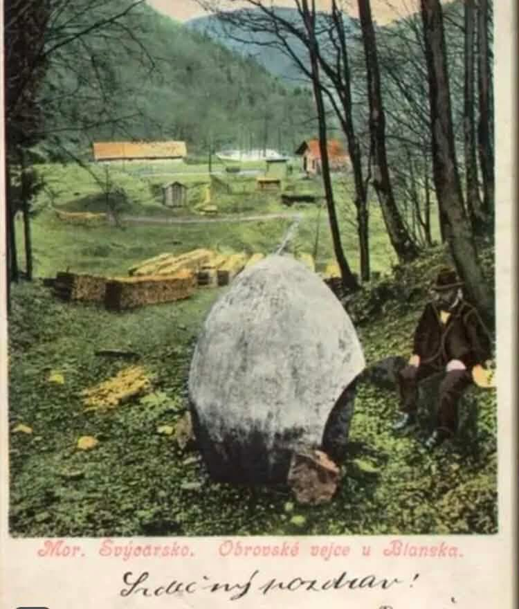
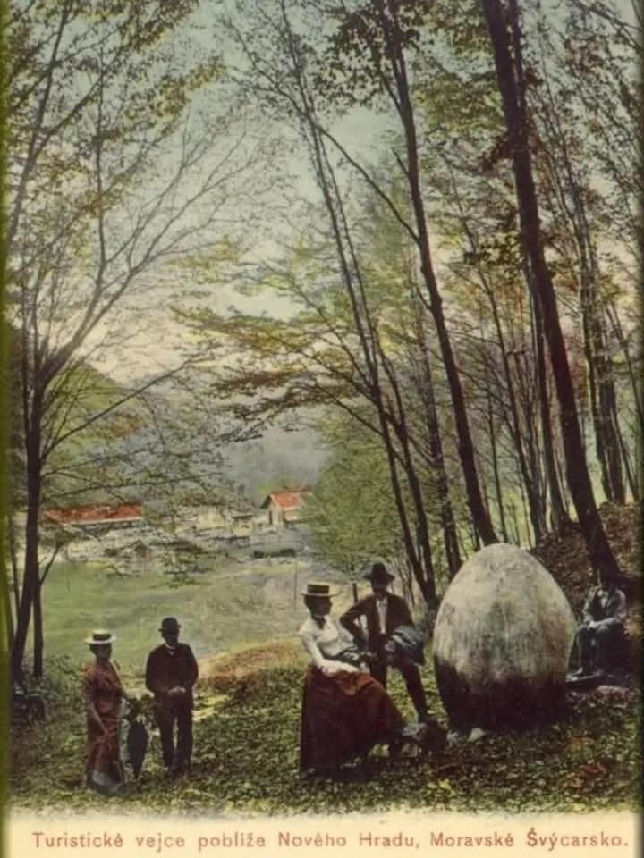

# Betonové vejce

**List:** Okolí Blanska  
**Trello:** <https://trello.com/c/oYAvn0hd/71-betonov%C3%A9-vejce>  

[← zpět na list](../README.md)

## Popis

https://www.facebook.com/share/p/paz59614iAiUo1te/

🥚 BETONOVÉ VEJCE POD NOVÝM HRADEM

Víte, že se nedaleko Adamova kdysi nacházela opravdu neobvyklá turistická atrakce? Obrovské betonové vejce, které ukrývalo pramen čisté vody!

Tuto zvláštní stavbu nechal podle historických pramenů vybudovat železniční inženýr Wolf, který se podílel na výstavbě železniční tratě v údolí Svitavy v první polovině 19. století.

Vajíčko nebylo jen praktickou ochranou pramene. Mělo také symbolický význam. Jindřich Wankel ho popisoval jako symbol vesmíru, z jehož nitra vyvěrá čistý a jasný, vše oživující živel – voda.

Stálo pod Novým hradem, nedaleko severního portálu Novohradského tunelu, při staré cestě vedoucí horským sedlem k hradu. Díky svému neobvyklému vzhledu se stalo oblíbeným výletním cílem a dostalo se dokonce na dobové pohlednice.

Co se s ním stalo? Přesně se to neví. Pravděpodobně zaniklo ve druhé polovině 20. století při stavebních úpravách souvisejících s budováním silnice. Dnes už po něm v terénu nezůstaly žádné známé stopy.

❓ Znáte tuto stavbu z vyprávění nebo máte doma její starou pohlednici? Budeme rádi, když se o své vzpomínky podělíte v komentářích.

## Přílohy (4)

